# Uber UI Reference Design System

You are building UI for **Uber UI Reference**. Light-themed, neutral palette, sans-serif typography (UberMove), compact density on a 4px grid.

## Visual Reference

**IMPORTANT**: Study ALL screenshots below before writing any UI. Match colors, typography, spacing, layout, and motion exactly as shown.

### Homepage

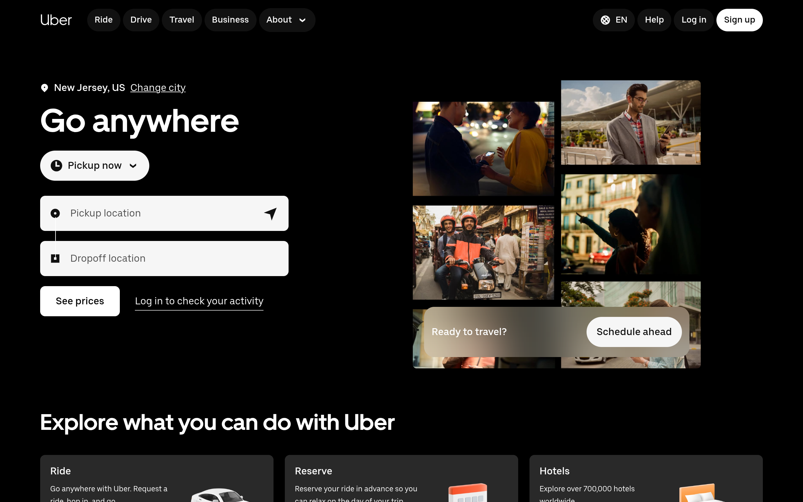

### Scroll Journey (Cinematic Visual States)

> These screenshots capture the website at different scroll depths. The design changes dramatically as you scroll — each frame shows a different cinematic state. Replicate these exact visual transitions.

#### 0% — Hero / Above the fold

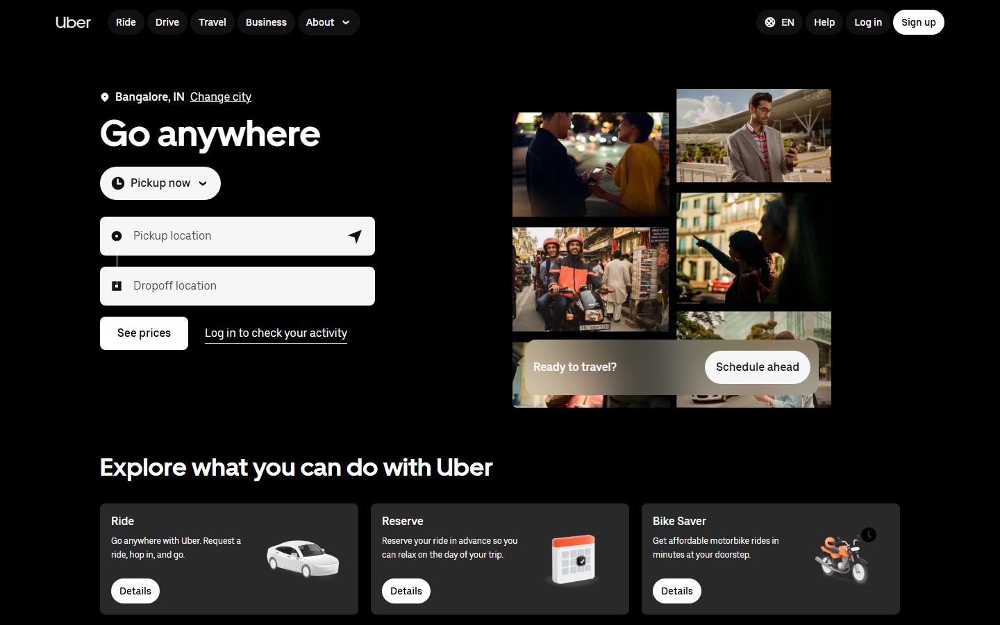

#### 17% — Mid-page at 17% scroll

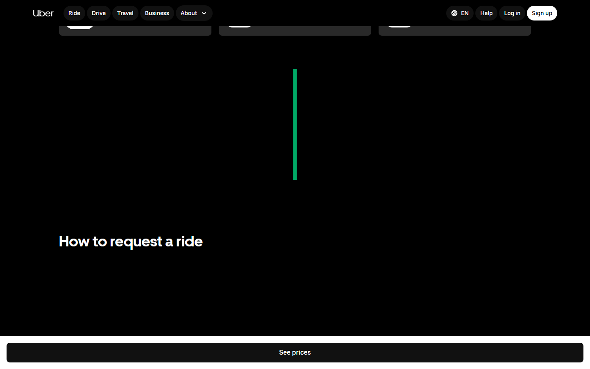

#### 33% — Mid-page at 33% scroll

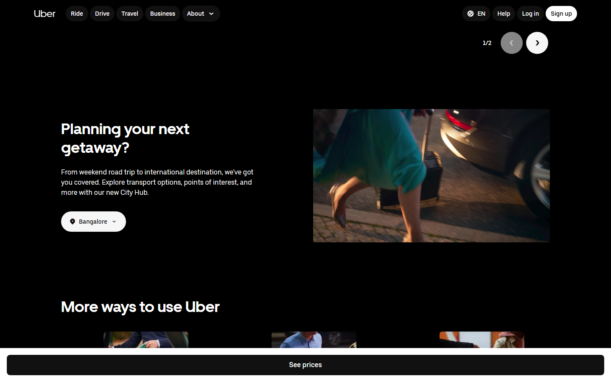

#### 50% — Mid-page at 50% scroll

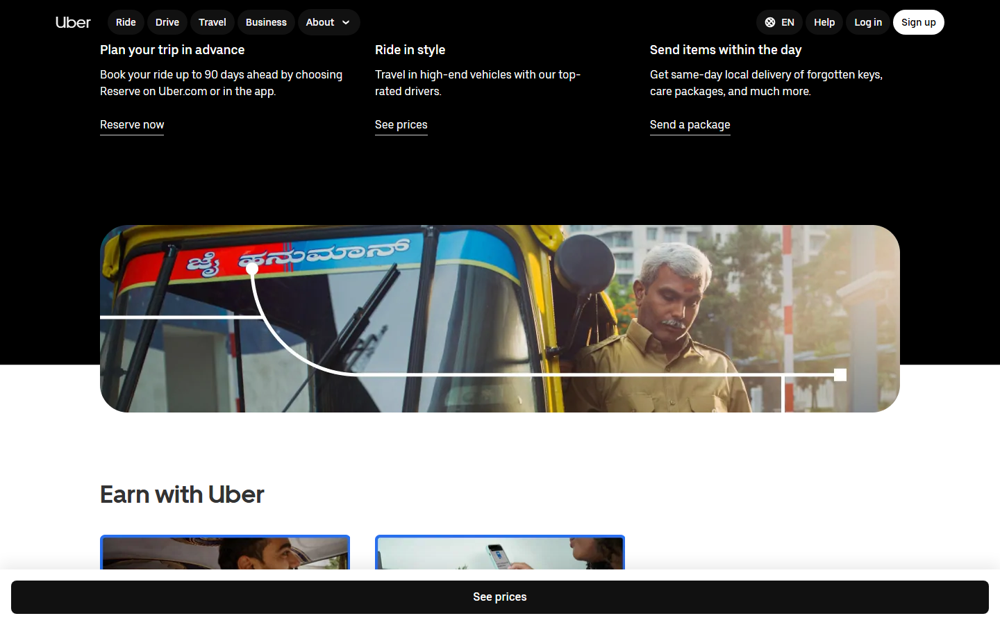

#### 67% — Mid-page at 67% scroll

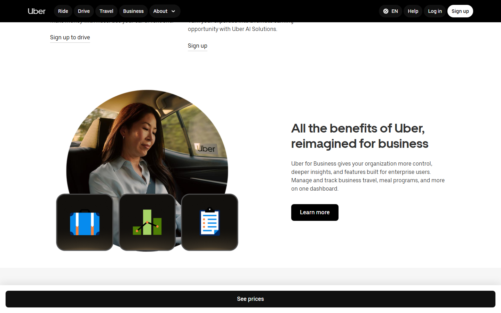

#### 83% — Mid-page at 83% scroll

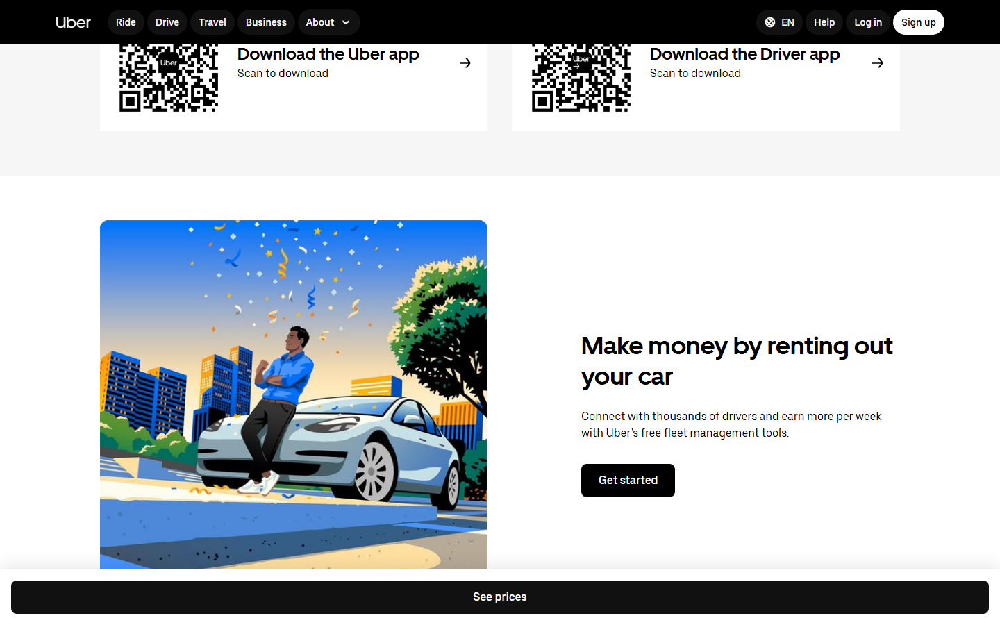

#### 100% — Footer / End of page

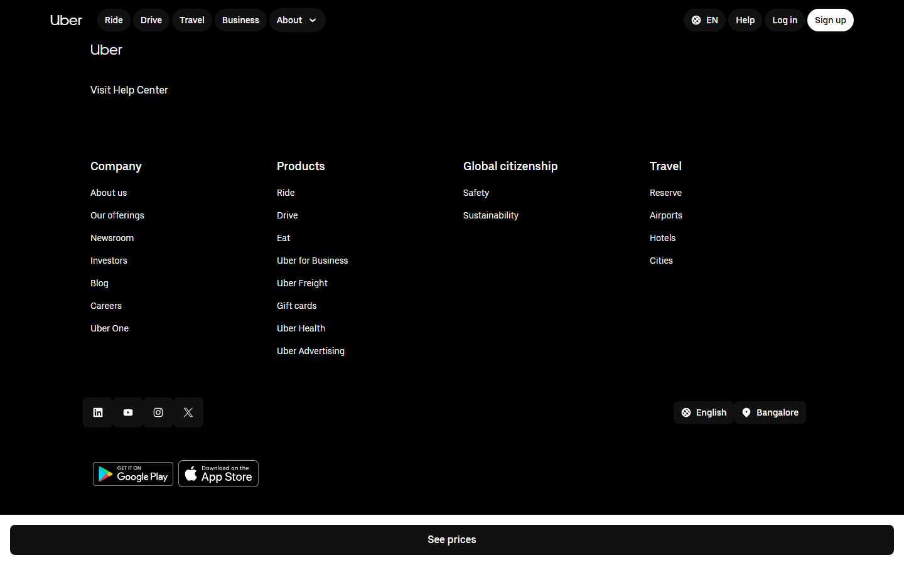

> Read `references/DESIGN.md` for full token details. Read `references/ANIMATIONS.md` for motion specs. Read `references/LAYOUT.md` for layout structure. Read `references/COMPONENTS.md` for component patterns.

## Ultra Reference Files

This package includes extended documentation. **Read these files before implementing:**

| File | Contents |
|------|----------|
| `references/DESIGN.md` | Full design system tokens, colors, typography, spacing |
| `references/VISUAL_GUIDE.md` | **START HERE** — Master visual guide with all screenshots embedded |
| `references/ANIMATIONS.md` | CSS keyframes, scroll triggers, motion library stack, video specs |
| `references/LAYOUT.md` | Flex/grid containers, page structure, spacing relationships |
| `references/COMPONENTS.md` | DOM component patterns, HTML structure, class fingerprints |
| `references/INTERACTIONS.md` | Hover/focus states with before/after style diffs |
| `screens/scroll/` | 7 scroll journey screenshots showing cinematic states |

## Design Philosophy

- **Layered depth** — use shadow tokens to create a sense of physical layering. Each elevation level has a specific shadow.
- **Gradient accents** — gradients are used thoughtfully for emphasis, not decoration.
- **Type pairing** — UberMove for body/UI text, UberMoveText for headings/display. Never introduce a third typeface.
- **compact density** — 4px base grid. Every dimension is a multiple of 4.
- **neutral palette** — the color temperature runs neutral, matching the sans-serif typography.
- **Subtle motion** — transitions smooth state changes. Keep durations under 300ms, use ease-out curves.

## Color System

### Core Palette

| Role | Token | Hex | Use |
|------|-------|-----|-----|
| Background | `--background` | `#ffffff` | Page/app background |
| Surface | `--surface` | `#f6f6f6` | Cards, panels, modals |
| Text Primary | `--text-primary` | `#111111` | Headings, body text |
| Text Muted | `--text-muted` | `#525252` | Captions, placeholders |
| Border | `--border` | `#333333` | Dividers, card borders |

### Status Colors

| Status | Hex | Use |
|--------|-----|-----|
| Danger | `#fee6e1` | Errors, destructive actions |

### Extended Palette

- **base-background-overlay-art:** `#000000` — Modal/dialog backdrop overlay
- **base-border-subtle:** `#c4c4c4` — Secondary text, placeholder text
- **base-background-disabled:** `#e0e0e0`
- **base-info-border-subtle:** `#777777` — Secondary text, placeholder text
- **base-background-track:** `#6b6b6b`
- **base-border-inverse-subtle:** `#b7b7b7` — Secondary text, placeholder text
- `#0000ee`
- **base-background-track:** `#5f5f5f`

### CSS Variable Tokens

```css
--base-red-background-material-bold-stop-0: #f43b00;
--base-red-background-material-bold-stop-100: #e42500;
--base-orange-background-material-bold-stop-0: #fc993c;
--base-orange-background-material-bold-stop-100: #fb762e;
--base-yellow-background-material-bold-stop-0: #f7e431;
--base-yellow-background-material-bold-stop-100: #f1d223;
--base-green-background-material-bold-stop-0: #0ca555;
--base-green-background-material-bold-stop-100: #098042;
--base-blue-background-material-bold-stop-0: #1697e7;
--base-blue-background-material-bold-stop-100: #1175dd;
--base-crimson-background-material-bold-stop-0: #e0336c;
--base-crimson-background-material-bold-stop-100: #d32753;
--base-background-base: var(--base-neutral-99);
--base-background-primary: var(--base-neutral-100);
--base-background-secondary: var(--base-neutral-98);
--base-background-tertiary: var(--base-neutral-96);
--base-background-disabled: rgba(224,224,224,0.6);
--base-background-always-dark: var(--base-neutral-0);
--base-background-always-light: var(--base-neutral-100);
--base-background-track: rgba(107,107,107,0.06);
```

## Typography

### Font Stack

- **UberMove** — Heading 1, Heading 2, Heading 3
- **UberMoveText** — Body, Caption

### Font Sources

```css
@font-face {
  font-family: "Book";
  src: url("fonts/Book-Regular.woff2") format("woff2");
  font-weight: 400;
}
@font-face {
  font-family: "Medium";
  src: url("fonts/Medium-Regular.woff2") format("woff2");
  font-weight: 400;
}
@font-face {
  font-family: "NarrowBook";
  src: url("fonts/NarrowBook-Regular.woff2") format("woff2");
  font-weight: 400;
}
@font-face {
  font-family: "NarrowMedium";
  src: url("fonts/NarrowMedium-Regular.woff2") format("woff2");
  font-weight: 400;
}
@font-face {
  font-family: "NarrowNews";
  src: url("fonts/NarrowNews-Regular.woff2") format("woff2");
  font-weight: 400;
}
@font-face {
  font-family: "NarrowThin";
  src: url("fonts/NarrowThin-Regular.woff2") format("woff2");
  font-weight: 400;
}
@font-face {
  font-family: "News";
  src: url("fonts/News-Regular.woff2") format("woff2");
  font-weight: 400;
}
@font-face {
  font-family: "Thin";
  src: url("fonts/Thin-Regular.woff2") format("woff2");
  font-weight: 400;
}
@font-face {
  font-family: "UberMove";
  src: url("fonts/UberMove-Regular.woff2") format("woff2");
  font-weight: 400;
}
@font-face {
  font-family: "UberMoveText";
  src: url("fonts/UberMoveText-Regular.woff2") format("woff2");
  font-weight: 400;
}
```

### Type Scale

| Role | Family | Size | Weight |
|------|--------|------|--------|
| Heading 1 | UberMove | 88px | 700 |
| Heading 2 | UberMove | 58px | 700 |
| Heading 3 | UberMove | 52px | 700 |
| Body | UberMoveText | 16px | 400 |
| Caption | UberMoveText | 14px | 400 |

### Typography Rules

- Body/UI: **UberMove**, Headings: **UberMoveText** — these are the only display fonts
- Max 3-4 font sizes per screen
- Headings: weight 600-700, body: weight 400
- Use color and opacity for text hierarchy, not additional font sizes
- Line height: 1.5 for body, 1.2 for headings

## Spacing & Layout

### Base Grid: 4px

Every dimension (margin, padding, gap, width, height) must be a multiple of **4px**.

### Spacing Scale

`2, 4, 6, 8, 10, 12, 14, 16, 18, 20, 22, 24` px

### Spacing as Meaning

| Spacing | Use |
|---------|-----|
| 4-8px | Tight: related items (icon + label, avatar + name) |
| 12-16px | Medium: between groups within a section |
| 24-32px | Wide: between distinct sections |
| 48px+ | Vast: major page section breaks |

### Border Radius

Scale: `0px 0px 8px 8px, 4px, 6px, 8px, 8px 8px 0px 0px, 12px, 16px, 100%, 999px, 1000px`
Default: `12px`

### Container

Max-width: `1136px`, centered with auto margins.

### Breakpoints

| Name | Value |
|------|-------|
| xs | 320px |
| sm | 600px |
| md | 767px |
| md | 768px |
| lg | 1023px |
| lg | 1024px |
| xl | 1119px |
| xl | 1120px |
| xl | 1136px |

Mobile-first: design for small screens, layer on responsive overrides.

## Component Patterns

### Card

```css
.card {
  background: #f6f6f6;
  border: 1px solid #333333;
  border-radius: 12px;
  padding: 16px;
  box-shadow: inset 0 0 0 1px var(--action-button-border);
}
```

```html
<div class="card">
  <h3>Card Title</h3>
  <p>Card content goes here.</p>
</div>
```

### Button

```css
/* Primary */
.btn-primary {
  background: #cccccc;
  color: #111111;
  border-radius: 12px;
  padding: 8px 16px;
  font-weight: 500;
  transition: opacity 150ms ease;
}
.btn-primary:hover { opacity: 0.9; }

/* Ghost */
.btn-ghost {
  background: transparent;
  border: 1px solid #333333;
  color: #111111;
  border-radius: 12px;
  padding: 8px 16px;
}
```

```html
<button class="btn-primary">Get Started</button>
<button class="btn-ghost">Learn More</button>
```

### Input

```css
.input {
  background: #ffffff;
  border: 1px solid #333333;
  border-radius: 12px;
  padding: 8px 12px;
  color: #111111;
  font-size: 14px;
}
.input:focus { border-color: var(--accent); outline: none; }
```

```html
<input class="input" type="text" placeholder="Search..." />
```

### Badge / Chip

```css
.badge {
  display: inline-flex;
  align-items: center;
  padding: 4px 8px;
  border-radius: 9999px;
  font-size: 12px;
  font-weight: 500;
  background: #f6f6f6;
  color: #525252;
}
```

```html
<span class="badge">New</span>
<span class="badge">Beta</span>
```

### Modal / Dialog

```css
.modal-backdrop { background: rgba(0, 0, 0, 0.6); }
.modal {
  background: #f6f6f6;
  border: 1px solid #333333;
  border-radius: 1000px;
  padding: 24px;
  max-width: 480px;
  width: 90vw;
  box-shadow: 0 4px 16px hsla(0,0%,0%,0.16);
}
```

```html
<div class="modal-backdrop">
  <div class="modal">
    <h2>Dialog Title</h2>
    <p>Dialog content.</p>
    <button class="btn-primary">Confirm</button>
    <button class="btn-ghost">Cancel</button>
  </div>
</div>
```

### Table

```css
.table { width: 100%; border-collapse: collapse; }
.table th {
  text-align: left;
  padding: 8px 12px;
  font-weight: 500;
  font-size: 12px;
  color: #525252;
  text-transform: uppercase;
  letter-spacing: 0.05em;
  border-bottom: 1px solid #333333;
}
.table td {
  padding: 12px;
  border-bottom: 1px solid #333333;
}
```

```html
<table class="table">
  <thead><tr><th>Name</th><th>Status</th><th>Date</th></tr></thead>
  <tbody>
    <tr><td>Item One</td><td>Active</td><td>Jan 1</td></tr>
    <tr><td>Item Two</td><td>Pending</td><td>Jan 2</td></tr>
  </tbody>
</table>
```

### Navigation

```css
.nav {
  display: flex;
  align-items: center;
  gap: 8px;
  padding: 12px 16px;
  border-bottom: 1px solid #333333;
}
.nav-link {
  color: #525252;
  padding: 8px 12px;
  border-radius: 12px;
  transition: color 150ms;
}
.nav-link:hover { color: #111111; }
```

```html
<nav class="nav">
  <a href="/" class="nav-link active">Home</a>
  <a href="/about" class="nav-link">About</a>
  <a href="/pricing" class="nav-link">Pricing</a>
  <button class="btn-primary" style="margin-left: auto">Get Started</button>
</nav>
```

### Extracted Components

These components were found in the codebase:

**Button** (`html`)

## Page Structure

The following page sections were detected:

- **Navigation** — Top navigation bar (37 items)
- **Hero** — Hero section (detected from heading structure)
- **Faq** — FAQ/accordion section
- **Footer** — Page footer with links and info (32 items)

When building pages, follow this section order and structure.

## Animation & Motion

This project uses **subtle motion**. Transitions smooth state changes without calling attention.

### CSS Animations

- `action-button-module__action-button-spin___GydB6`
- `animation-dkKkL`

### Motion Tokens

- **Duration scale:** `1.5s`, `100ms`, `200ms`, `250ms`, `300ms`, `400ms`, `500ms`, `650ms`, `1000ms`
- **Easing functions:** `ease-out`, `cubic-bezier(0.22,1,0.36,1)`, `cubic-bezier(0,0,1,1)`, `cubic-bezier(.2,.8,.4,1)`, `cubic-bezier(0.2,0.8,0.4,1)`, `ease-in-out`, `cubic-bezier(0.4,0,0.2,1)`, `ease`
- **Animated properties:** `transform`

### Motion Guidelines

- **Duration:** Use values from the duration scale above. Short (1.5s) for micro-interactions, long (1000ms) for page transitions
- **Easing:** Use `ease-out` as the default easing curve
- **Direction:** Elements enter from bottom/right, exit to top/left
- **Reduced motion:** Always respect `prefers-reduced-motion` — disable animations when set

## Depth & Elevation

### Shadow Tokens

- Subtle: `inset 0 0 0 1px var(--action-button-border)`
- Subtle: `inset 0 0 0 2px #FCFCFC,0 0 0 2px #276EF1`
- Floating (dropdowns, popovers): `0 4px 16px hsla(0,0%,0%,0.16)`
- Floating (dropdowns, popovers): `0px 4px 16px rgba(0,0,0,0.12)`
- Floating (dropdowns, popovers): `rgba(0,0,0,0.08) 0px -8px 20px 0px`
- Overlay (modals, dialogs): `inset 999px 999px 0px rgba(236,236,236,0.15)`

### Z-Index Scale

`0, 1, 2, 1000, 2001, 2002, 3000, 2147483647`

Use these exact values — never invent z-index values.

## Anti-Patterns (Never Do)

- **No blur effects** — no backdrop-blur, no filter: blur()
- **No zebra striping** — tables and lists use borders for separation
- **No invented colors** — every hex value must come from the palette above
- **No arbitrary spacing** — every dimension is a multiple of 4px
- **No extra fonts** — only UberMove and UberMoveText are allowed
- **No arbitrary border-radius** — use the scale: 4px, 6px, 8px, 12px, 16px, 999px, 1000px
- **No opacity for disabled states** — use muted colors instead

## Workflow

1. **Read** `references/DESIGN.md` before writing any UI code
2. **Pick colors** from the Color System section — never invent new ones
3. **Set typography** — UberMove, UberMoveText only, using the type scale
4. **Build layout** on the 4px grid — check every margin, padding, gap
5. **Match components** to patterns above before creating new ones
6. **Apply elevation** — use shadow tokens
7. **Validate** — every value traces back to a design token. No magic numbers.

## Brand Spec

- **Favicon:** `/_static/99c4bc580c8b57b7.ico`
- **Site URL:** `https://www.uber.com/in/en/`
- **Brand typeface:** UberMove

## Quick Reference

```
Background:     #ffffff
Surface:        #f6f6f6
Text:           #111111 / #525252
Accent:         (not extracted)
Border:         #333333
Font:           UberMove
Spacing:        4px grid
Radius:         12px
Components:     8 detected
```

## When to Trigger

Activate this skill when:
- Creating new components, pages, or visual elements for Uber UI Reference
- Writing CSS, Tailwind classes, styled-components, or inline styles
- Building page layouts, templates, or responsive designs
- Reviewing UI code for design consistency
- The user mentions "Uber UI Reference" design, style, UI, or theme
- Generating mockups, wireframes, or visual prototypes

---

# Full Reference Files

> Every output file is embedded below. Claude has full design system context from /skills alone.

## Design System Tokens (DESIGN.md)

# Uber UI Reference DESIGN.md

> Auto-generated design system — reverse-engineered via static analysis by skillui.
> Frameworks: None detected
> Colors: 20 · Fonts: 2 · Components: 8
> Icon library: not detected · State: not detected
> Primary theme: light · Dark mode toggle: no · Motion: subtle

## Visual Reference

**Match this design exactly** — study colors, fonts, spacing, and component shapes before writing any UI code.


---

## 1. Visual Theme & Atmosphere

This is a **light-themed** interface with a neutral, approachable feel. The light background emphasizes content clarity. Typography pairs **UberMoveText** for display/headings with **UberMove** for body text, creating clear visual hierarchy through type contrast. Spacing follows a **4px base grid** (compact density), with scale: 2, 4, 6, 8, 10, 12, 14, 16px. Motion is subtle — smooth transitions (150-300ms) ease state changes without drawing attention.

---

## 2. Color Palette & Roles

| Token | Hex | Role | Use |
|---|---|---|---|
| base-background-material-primary | `#ffffff` | background | Page background, darkest surface |
| surface | `#f6f6f6` | surface | Card and panel backgrounds |
| base-background-statelayer-hover | `#111111` | text-primary | Headings and body text |
| base-border-inverse-subtle | `#525252` | text-muted | Captions, placeholders, secondary info |
| border | `#333333` | border | Dividers, card borders, outlines |
| base-error-background-disabled | `#fee6e1` | danger | Error states, destructive actions |
| info | `#0000ee` | info | Informational highlights |
| base-background-overlay-art | `#000000` | unknown | Palette color |
| base-border-subtle | `#c4c4c4` | unknown | Palette color |
| base-background-disabled | `#e0e0e0` | unknown | Palette color |
| base-info-border-subtle | `#777777` | unknown | Palette color |
| base-background-track | `#6b6b6b` | unknown | Palette color |
| base-border-inverse-subtle | `#b7b7b7` | unknown | Palette color |
| base-background-track | `#5f5f5f` | unknown | Palette color |
| base-background-inverse-statelayer-hover | `#ececec` | unknown | Palette color |
| unknown | `#068bee` | unknown | Palette color |
| base-background-disabled | `#474747` | unknown | Palette color |
| base-background-material-primary | `#272727` | unknown | Palette color |
| unknown | `#276ef1` | unknown | Palette color |
| base-error-background-statelayer-hover | `#31110b` | unknown | Palette color |

### CSS Variable Tokens

```css
--base-red-background-material-bold-stop-0: #f43b00;
--base-red-background-material-bold-stop-100: #e42500;
--base-orange-background-material-bold-stop-0: #fc993c;
--base-orange-background-material-bold-stop-100: #fb762e;
--base-yellow-background-material-bold-stop-0: #f7e431;
--base-yellow-background-material-bold-stop-100: #f1d223;
--base-green-background-material-bold-stop-0: #0ca555;
--base-green-background-material-bold-stop-100: #098042;
--base-blue-background-material-bold-stop-0: #1697e7;
--base-blue-background-material-bold-stop-100: #1175dd;
--base-crimson-background-material-bold-stop-0: #e0336c;
--base-crimson-background-material-bold-stop-100: #d32753;
--base-background-base: var(--base-neutral-99);
--base-background-primary: var(--base-neutral-100);
--base-background-secondary: var(--base-neutral-98);
--base-background-tertiary: var(--base-neutral-96);
--base-background-disabled: rgba(224,224,224,0.6);
--base-background-always-dark: var(--base-neutral-0);
--base-background-always-light: var(--base-neutral-100);
--base-background-track: rgba(107,107,107,0.06);
```


---

## 3. Typography Rules

**Font Stack:**
- **UberMove** — Heading 1, Heading 2, Heading 3
- **UberMoveText** — Body, Caption

**Font Sources:**

```css
@font-face {
  font-family: "Book";
  src: url("fonts/Book-Regular.woff2") format("woff2");
  font-weight: 400;
}
@font-face {
  font-family: "Medium";
  src: url("fonts/Medium-Regular.woff2") format("woff2");
  font-weight: 400;
}
@font-face {
  font-family: "NarrowBook";
  src: url("fonts/NarrowBook-Regular.woff2") format("woff2");
  font-weight: 400;
}
@font-face {
  font-family: "NarrowMedium";
  src: url("fonts/NarrowMedium-Regular.woff2") format("woff2");
  font-weight: 400;
}
@font-face {
  font-family: "NarrowNews";
  src: url("fonts/NarrowNews-Regular.woff2") format("woff2");
  font-weight: 400;
}
@font-face {
  font-family: "NarrowThin";
  src: url("fonts/NarrowThin-Regular.woff2") format("woff2");
  font-weight: 400;
}
@font-face {
  font-family: "News";
  src: url("fonts/News-Regular.woff2") format("woff2");
  font-weight: 400;
}
@font-face {
  font-family: "Thin";
  src: url("fonts/Thin-Regular.woff2") format("woff2");
  font-weight: 400;
}
@font-face {
  font-family: "UberMove";
  src: url("fonts/UberMove-Regular.woff2") format("woff2");
  font-weight: 400;
}
@font-face {
  font-family: "UberMoveText";
  src: url("fonts/UberMoveText-Regular.woff2") format("woff2");
  font-weight: 400;
}
```

| Role | Font | Size | Weight |
|---|---|---|---|
| Heading 1 | UberMove | 88px | 700 |
| Heading 2 | UberMove | 58px | 700 |
| Heading 3 | UberMove | 52px | 700 |
| Body | UberMoveText | 16px | 400 |
| Caption | UberMoveText | 14px | 400 |

**Typographic Rules:**
- Limit to 2 font families max per screen
- Use **UberMove** for body/UI text, **UberMoveText** for display/headings
- Maintain consistent hierarchy: no more than 3-4 font sizes per screen
- Headings use bold (600-700), body uses regular (400)
- Line height: 1.5 for body text, 1.2 for headings
- Use color and opacity for secondary hierarchy, not additional font sizes


---

## 4. Component Stylings

### Layout (1)

**Footer** — `html`

### Navigation (1)

**Navigation** — `html`

### Data Display (1)

**Badge** — `html`

### Data Input (1)

**Button** — `html`
- Animation: 

### Overlay (1)

**Modal** — `html`

### Media (3)

**Image** — `html`

**Icon** — `html`

**Map/Canvas** — `html`


---

## 5. Layout Principles

- **Base spacing unit:** 4px
- **Spacing scale:** 2, 4, 6, 8, 10, 12, 14, 16, 18, 20, 22, 24
- **Border radius:** 0px 0px 8px 8px, 4px, 6px, 8px, 8px 8px 0px 0px, 12px, 16px, 100%, 999px, 1000px
- **Max content width:** 1136px

**Spacing as Meaning:**
| Spacing | Use |
|---|---|
| 4-8px | Tight: related items within a group |
| 12-16px | Medium: between groups |
| 24-32px | Wide: between sections |
| 48px+ | Vast: major section breaks |


---

## 6. Depth & Elevation

### Flat — subtle depth hints

- `inset 0 0 0 1px var(--action-button-border)`
- `inset 0 0 0 2px #FCFCFC,0 0 0 2px #276EF1`

### Floating — dropdowns, popovers, modals

- `0 4px 16px hsla(0,0%,0%,0.16)`
- `0px 4px 16px rgba(0,0,0,0.12)`
- `rgba(0,0,0,0.08) 0px -8px 20px 0px`

### Overlay — full-screen overlays, top-level dialogs

- `inset 999px 999px 0px rgba(236,236,236,0.15)`
- `inset 999px 999px 0px rgba(236,236,236,0.2)`
- `inset 999px 999px 0px rgba(17,17,17,0.06)`

### Z-Index Scale

`0, 1, 2, 1000, 2001, 2002, 3000, 2147483647`


---

## 7. Animation & Motion

This project uses **subtle motion**. Transitions smooth state changes without demanding attention.

### CSS Animations

- `@keyframes action-button-module__action-button-spin___GydB6`
- `@keyframes animation-dkKkL`

### Animated Components

- **Button**: 

### Motion Guidelines

- Duration: 150-300ms for micro-interactions, 300-500ms for page transitions
- Easing: `ease-out` for enters, `ease-in` for exits
- Always respect `prefers-reduced-motion`


---

## 8. Do's and Don'ts

### Do's

- Use `#ffffff` as the primary page background
- Pair **UberMove** (body) with **UberMoveText** (display) — these are the only allowed fonts
- Follow the **4px** spacing grid for all margins, padding, and gaps
- Use the defined shadow tokens for elevation — see Section 6
- Use border-radius from the scale: 0px 0px 8px 8px, 4px, 6px, 8px, 8px 8px 0px 0px
- Reuse existing components from Section 4 before creating new ones

### Don'ts

- Don't introduce colors outside this palette — extend the design tokens first
- Don't introduce additional font families beyond UberMove and UberMoveText
- Don't use arbitrary spacing values — stick to multiples of 4px
- Don't create custom box-shadow values outside the system tokens
- Don't use arbitrary border-radius values — pick from the defined scale
- Don't duplicate component patterns — check Section 4 first
- Don't use backdrop-blur or blur effects

### Anti-Patterns (detected from codebase)

- No blur or backdrop-blur effects
- No zebra striping on tables/lists


---

## 9. Responsive Behavior

| Name | Value | Source |
|---|---|---|
| xs | 320px | css |
| sm | 600px | css |
| md | 767px | css |
| md | 768px | css |
| lg | 1023px | css |
| lg | 1024px | css |
| xl | 1119px | css |
| xl | 1120px | css |
| xl | 1136px | css |

**Approach:** Use `@media (min-width: ...)` queries matching the breakpoints above.


---

## 10. Agent Prompt Guide

Use these as starting points when building new UI:

### Build a Card

```
Background: #f6f6f6
Border: 1px solid #333333
Radius: 12px
Padding: 16px
Font: UberMove
Use shadow tokens from Section 6.
```

### Build a Button

```
Primary: bg var(--accent), text white
Ghost: bg transparent, border #333333
Padding: 8px 16px
Radius: 12px
Hover: opacity 0.9 or lighter shade
Focus: ring with var(--accent)
```

### Build a Page Layout

```
Background: #ffffff
Max-width: 1136px, centered
Grid: 4px base
Responsive: mobile-first, breakpoints from Section 9
```

### Build a Stats Card

```
Surface: #f6f6f6
Label: #525252 (muted, 12px, uppercase)
Value: #111111 (primary, 24-32px, bold)
Status: use success/warning/danger from Section 2
```

### Build a Form

```
Input bg: #ffffff
Input border: 1px solid #333333
Focus: border-color var(--accent)
Label: #525252 12px
Spacing: 16px between fields
Radius: 12px
```

### General Component

```
1. Read DESIGN.md Sections 2-6 for tokens
2. Colors: only from palette
3. Font: UberMove, type scale from Section 3
4. Spacing: 4px grid
5. Components: match patterns from Section 4
6. Elevation: shadow tokens
```

## Visual Guide — Screenshots (VISUAL_GUIDE.md)

# Uber UI Reference — Visual Guide

> Master visual reference. Study every screenshot carefully before implementing any UI.
> Match colors, layout, typography, spacing, and motion states exactly.

## Scroll Journey

The page has cinematic scroll animations. Each screenshot below shows the exact visual state at that scroll depth.
**Replicate these transitions precisely** — the design changes dramatically as you scroll.

### Hero — Above the fold

*Scroll position: 0px of 6667px total*


### 17% scroll depth

*Scroll position: 980px of 6667px total*


### 33% scroll depth

*Scroll position: 1903px of 6667px total*


### 50% scroll depth

*Scroll position: 2884px of 6667px total*


### 67% scroll depth

*Scroll position: 3864px of 6667px total*


### 83% scroll depth

*Scroll position: 4787px of 6667px total*


### Footer — End of page

*Scroll position: 5767px of 6667px total*


## Full Page Screenshots

### Earn Money by Driving or Get a Ride Now | Uber India

*URL: `https://www.uber.com/in/en/`*


### Explore the Uber Platform | Earn & Ride | Uber

*URL: `https://www.uber.com/in/en/city-hub/`*


### Corporate Travel, Food, & Delivery Services | Uber for Business

*URL: `https://www.uber.com/in/en/business/`*


### About Us | Uber

*URL: `https://www.uber.com/in/en/about/`*


### Uber Apps, Products, and Offerings | Uber

*URL: `https://www.uber.com/in/en/about/uber-offerings/`*


### How Uber Works for Drivers and Riders | Overview

*URL: `https://www.uber.com/in/en/about/how-does-uber-work/`*


### Our Road to Zero Emissions | Uber

*URL: `https://www.uber.com/in/en/about/sustainability/`*


### Uber in New Delhi | A Guide to Getting Around in New Delhi

*URL: `https://www.uber.com/global/en/r/cities/new-delhi-new-delhi-in/`*


## Section Screenshots

Clipped sections showing individual components in context.

### Section 1 — `section`

*1440×587px*


### Section 2 — `section`

*1440×434px*


### Section 1 — `section`

*1440×816px*


### Section 1 — `section`

*1440×600px*


### Section 2 — `section`

*1440×346px*


### Section 1 — `section`

*1440×700px*


### Section 2 — `section`

*1440×336px*


### Section 1 — `section`

*1440×328px*


### Section 2 — `section`

*1440×303px*


### Section 3 — `section`

*1440×572px*


### Section 1 — `section`

*1440×686px*


### Section 2 — `section`

*1440×1200px*


### Section 1 — `section`

*1440×480px*


### Section 2 — `section`

*1440×1200px*


### Section 1 — `section`

*1440×640px*


### Section 2 — `section`

*1440×835px*


## Animations & Motion (ANIMATIONS.md)

# Animation Reference

> Cinematic motion design extracted from live DOM. Follow these specs exactly to recreate the experience.

## Motion Technology Stack

Pure CSS animations — no external animation libraries detected.

## Scroll Journey

The page is **6,667px** tall. Each frame below shows what the user sees at that scroll depth.

> **Use these screenshots to understand WHAT animates, WHEN it animates, and HOW it moves.**

### 0% — Top / Hero
Scroll position: 0px


### 17% — Opening Section
Scroll position: 980px


### 33% — First Feature Section
Scroll position: 1,903px


### 50% — Mid-Page
Scroll position: 2,884px


### 67% — Lower Content
Scroll position: 3,864px


### 83% — Near Footer
Scroll position: 4,787px


### 100% — Bottom / Footer
Scroll position: 5,767px


## Video Elements

| # | Role | Autoplay | Loop | Muted | Size | First Frame |
|---|------|----------|------|-------|------|-------------|
| 1 | content | ✓ | ✓ | ✓ | 558×318 | — |

- **Source:** `https://tb-static.uber.com/prod/uber-static/uber-sites/_video/Global Brand Experience/Go Get 2026/Event Day/02_Travel Mo`

## CSS Keyframes (2 extracted)

### `@keyframes animation-dkKkL`

Duration: `1.5s` · Easing: `ease-out` · Iteration: `infinite`

Used by: `.css-cCIVXL`, `.css-jUdoY`, `.css-bcXLoD`, `.css-iLAuZp`

```css
@keyframes animation-dkKkL {
  0% {
    background-position-x: 100%;
    background-position-y: 50%;
  }
  100% {
    background-position-x: 0%;
    background-position-y: 50%;
  }
}
```

> Background color/gradient shift · Background position (shimmer/scroll)

### `@keyframes action-button-module__action-button-spin___GydB6`

Duration: `700ms` · Easing: `linear` · Delay: `0s` · Iteration: `infinite` · Fill: `none`

Used by: `.action-button-module__loadingSpinner___U9YXk`

```css
@keyframes action-button-module__action-button-spin___GydB6 {
  0% {
    transform: rotate(0deg);
  }
  100% {
    transform: rotate(360deg);
  }
}
```

> Transform/motion animation

## Global Transition Declarations

These `transition` values were extracted from CSS rules across the site:

```css
transition: transform 200ms ease-out;
transition: 0.3s ease-in-out;
transition: 200ms cubic-bezier(0.4, 0, 0.2, 1);
transition: 200ms;
transition: 500ms cubic-bezier(0.22, 1, 0.36, 1);
transition: backgroundColor 500ms;
transition: transform 1000ms cubic-bezier(0.2, 0.8, 0.4, 1);
transition: 400ms;
transition: height 0.2s linear;
transition: width 0.3s linear;
transition: background-color 0.218s, border-color 0.218s;
transition: background-color 0.218s;
```

## How to Recreate This Motion Design

### Step 2 — Scroll-Reveal Pattern

Elements that animate into view follow this pattern:

```css
/* Initial hidden state */
.reveal {
  opacity: 0;
  transform: translateY(40px);
  transition: opacity 200ms cubic-bezier(0.4, 0, 0.2, 1),
              transform 200ms cubic-bezier(0.4, 0, 0.2, 1);
}
.reveal.visible {
  opacity: 1;
  transform: translateY(0);
}
```

### Step 3 — Key Motion Principles

- **Duration scale:** `200ms` · `0.3s` · `500ms` — use these values, never invent new durations
- **Always add** `@media (prefers-reduced-motion: reduce) { * { animation-duration: 0.01ms !important; transition-duration: 0.01ms !important; } }`

### Step 4 — Scroll Journey Reference

Match what happens at each scroll position:

- **0%** (`0px`) → `screens/scroll/scroll-000.png`
- **17%** (`980px`) → `screens/scroll/scroll-017.png`
- **33%** (`1903px`) → `screens/scroll/scroll-033.png`
- **50%** (`2884px`) → `screens/scroll/scroll-050.png`
- **67%** (`3864px`) → `screens/scroll/scroll-067.png`
- **83%** (`4787px`) → `screens/scroll/scroll-083.png`
- **100%** (`5767px`) → `screens/scroll/scroll-100.png`

## Layout & Grid (LAYOUT.md)

# Layout Reference

> Auto-extracted from live DOM. Use this to understand how the site is structured spatially.

## Spacing System

**Base grid:** 4px

**Scale:** `2, 4, 6, 8, 10, 12, 14, 16, 18, 20, 22, 24, 28, 30, 32` px

| Spacing | Semantic Use |
|---------|-------------|
| 4px | Tight — within a component |
| 8px | Medium — between sibling items |
| 16px | Wide — between sections |
| 32px | Vast — major section breaks |

## Flex Layouts

| Element | Direction | Justify | Align | Gap | Children |
|---------|-----------|---------|-------|-----|----------|
| `section.css-hBnhgZ` | row | — | — | — | 1 |
| `section.css-hBnhgZ` | row | — | — | — | 1 |
| `section.css-gqcHgx` | row | — | — | — | 1 |
| `nav.css-zFBBL` | row | — | — | — | 1 |
| `section.css-hBnhgZ` | row | — | — | — | 1 |
| `section.css-hBnhgZ` | row | — | — | — | 1 |
| `section.css-fdvnIH` | row | — | — | — | 1 |
| `section.css-iVbutM` | row | — | — | — | 1 |
| `section.css-fJRshr` | row | — | — | — | 1 |
| `section.css-fJRshr` | row | — | — | — | 1 |
| `section.css-hBnhgZ` | row | — | — | — | 1 |
| `section.css-jBUnZd` | row | — | — | — | 1 |
| `section.css-hBnhgZ` | row | — | — | — | 1 |
| `nav.css-bcpvQL` | row | flow-end | center | — | 2 |

## Structural Containers

### `<main>` (`main#main`)

```
display:          block
children:         27
```

### `<footer>` 

```
display:          block
children:         1
```

### `<section>` (`section.css-hBnhgZ`)

```
display:          flex
flex-direction:   row
justify-content:  —
align-items:      —
children:         1
```

### `<section>` (`section.css-hBnhgZ`)

```
display:          flex
flex-direction:   row
justify-content:  —
align-items:      —
children:         1
```

### `<section>` (`section.css-gqcHgx`)

```
display:          flex
flex-direction:   row
justify-content:  —
align-items:      —
children:         1
```

### `<nav>` (`nav.css-zFBBL`)

```
display:          flex
flex-direction:   row
justify-content:  —
align-items:      —
padding:          12px 0px
children:         1
```

### `<section>` (`section.css-hBnhgZ`)

```
display:          flex
flex-direction:   row
justify-content:  —
align-items:      —
children:         1
```

### `<section>` (`section.css-hBnhgZ`)

```
display:          flex
flex-direction:   row
justify-content:  —
align-items:      —
children:         1
```

### `<section>` (`section.css-fdvnIH`)

```
display:          flex
flex-direction:   row
justify-content:  —
align-items:      —
children:         1
```

### `<section>` (`section.css-iVbutM`)

```
display:          flex
flex-direction:   row
justify-content:  —
align-items:      —
children:         1
```

### `<section>` (`section.css-fJRshr`)

```
display:          flex
flex-direction:   row
justify-content:  —
align-items:      —
children:         1
```

### `<section>` (`section.css-fJRshr`)

```
display:          flex
flex-direction:   row
justify-content:  —
align-items:      —
children:         1
```

## Layout Rules

- Primary layout system: **Flexbox**
- Every spacing value must be a multiple of **4px**
- Never use arbitrary margin/padding values outside the spacing scale

## Component Patterns (COMPONENTS.md)

# Component Reference

> Repeated DOM patterns detected by structural analysis. Each component appeared 3+ times.

## Detected Components

| Component | Category | Instances | Key Classes |
|-----------|----------|-----------|-------------|
| **Css PKJb** | unknown | 44× | `.css-PKJb` |
| **Css HazmlH** | unknown | 11× | `.css-hazmlH` |
| **Css DmafOG** | unknown | 10× | `.css-dmafOG` |
| **Css OfGld** | unknown | 9× | `.css-ofGld` |
| **Css PKJb** | unknown | 7× | `.css-PKJb` |
| **Css BVFrLX** | unknown | 7× | `.css-bVFrLX` |
| **Css ZwMiT** | unknown | 7× | `.css-ZwMiT` |
| **Css HBnhgZ** | unknown | 6× | `.css-hBnhgZ` |
| **Css BpZUjh** | unknown | 6× | `.css-bpZUjh` |
| **Css KZpscH** | unknown | 6× | `.css-kZpscH` |
| **Css FwsLmT** | unknown | 6× | `.css-fwsLmT` |
| **Css DuzbdR** | list-item | 6× | `.css-duzbdR`, `.undefined` |
| **Css IwCxLf** | unknown | 6× | `.css-iwCxLf` |
| **Css ULdFU** | unknown | 6× | `.css-ULdFU` |
| **Css FuBCQx** | unknown | 6× | `.css-fuBCQx` |
| **Css LiSmO** | unknown | 6× | `.css-LiSmO`, `.css-kzGGeg` |
| **Css IJiqqk** | list-item | 5× | `.css-iJiqqk` |
| **Css MDldu** | unknown | 5× | `.css-MDldu` |
| **Css GeNvgm** | unknown | 4× | `.css-geNvgm` |
| **Container Inner** | unknown | 3× | `.container-inner`, `.css-aiKAo` |

## List Items

### Css DuzbdR

**Instances found:** 6

**CSS classes:** `.css-duzbdR` `.undefined`

**HTML structure:**

```html
<li class="css-duzbdR undefined" data-testid="product-suggestion-tile"><a aria-label="Ride, Details" class="css-iwCxLf" data-funnel="rider-redirection" data-testid="product-suggestion-link" href="https://m.uber.com/looking/"><div class="css-ULdFU"><div><div data-baseweb="typo-labelmedium" data-testid="product-suggestion-primary-text" class="css-fuBCQx">Ride</div><p data-baseweb="typo-paragraphxsmall" class="css-LiSmO css-kzGGeg" data-testid="product-suggestion-secondary-text" title="Go anywhere with Uber. Request a ride, hop in, and go.">Go anywhere with Uber. Request a ride, h…</p></div><div 
```

**Base styles (from design tokens):**

```css
.css-duzbdR {
  padding: 4px 0;
  border-bottom: 1px solid #333333;
}```

### Css IJiqqk

**Instances found:** 5

**CSS classes:** `.css-iJiqqk`

**HTML structure:**

```html
<li class="css-iJiqqk"><a data-baseweb="button" aria-label="Ride — Request a ride" href="https://m.uber.com/looking" target="_self" data-tracking-name="_79e70995-edbc-4fed-b2ca-3904aba7ac2d_links[0].link_cta6" class="css-MDldu">Ride</a></li>
```

**Base styles (from design tokens):**

```css
.css-iJiqqk {
  padding: 4px 0;
  border-bottom: 1px solid #333333;
}```

## Other Components

### Css PKJb

**Instances found:** 44

**CSS classes:** `.css-PKJb`

**HTML structure:**

```html
<div data-baseweb="block" class="css-PKJb"><div data-pudo-anchor="HEADING" class="css-etjCRc"><div data-testid="dotcom-ui.heading" class="css-hPnljU"><h1 data-testid="heading.base" class="css-cgxnTe">Go anywhere</h1></div></div></div>
```

**Base styles (from design tokens):**

```css
.css-PKJb {
  background: #f6f6f6;
  padding: 4px;
}```

### Css HazmlH

**Instances found:** 11

**CSS classes:** `.css-hazmlH`

**HTML structure:**

```html
<div data-baseweb="block" class="css-hazmlH"><div data-baseweb="block" class="css-ofGld"><div data-baseweb="block" class="container-inner css-aiKAo"><div data-baseweb="block" data-testid="block-container" class="css-bVFrLX"><div data-baseweb="block" class="css-iLHpJi"><div data-baseweb="block" class="css-cbdYOH"><div class="css-bYqxpw"><div data-pudo-anchor="EYEBROW_PROMPT" class="css-gjrQew"><svg aria-hidden="true" fill="currentColor" focusable="false" height="1em" width="1em" viewBox="0 0 14 14" color="white" class="css-jZqiAM"><path d="M10.9081 2.21665C8.74974 0.0583171 5.24974 0.0583171 3.
```

**Base styles (from design tokens):**

```css
.css-hazmlH {
  background: #f6f6f6;
  padding: 4px;
}```

### Css DmafOG

**Instances found:** 10

**CSS classes:** `.css-dmafOG`

**HTML structure:**

```html
<div data-testid="responsive.visibility.wrapper" class="css-dmafOG"><div data-hydrate-module-id="__fusion__20ac1f1ba2" data-hydrate-chunk-ids="[49438,62611,&quot;legacy-61493&quot;,&quot;legacy-87002&quot;]" data-hydrate-method="eager" data-hydrate-props="{&quot;additionalCta&quot;:{&quot;childNodes&quot;:[],&quot;component&quot;:&quot;Link&quot;,&quot;link&quot;:{&quot;ariaLabel&quot;:&quot;&quot;,&quot;href&quot;:&quot;https://help.uber.com/&quot;,&quot;openInNewTab&quot;:false,&quot;text&quot;:&quot;Help&quot;,&quot;data-tracking-name&quot;:&quot;_79e70995-edbc-4fed-b2ca-3904aba7ac2d_additi
```

**Base styles (from design tokens):**

```css
.css-dmafOG {
  background: #f6f6f6;
  padding: 4px;
}```

### Css OfGld

**Instances found:** 9

**CSS classes:** `.css-ofGld`

**HTML structure:**

```html
<div data-baseweb="block" class="css-ofGld"><div data-baseweb="block" class="container-inner css-aiKAo"><div data-baseweb="block" data-testid="block-container" class="css-bVFrLX"><div data-baseweb="block" class="css-iLHpJi"><div data-baseweb="block" class="css-cbdYOH"><div class="css-bYqxpw"><div data-pudo-anchor="EYEBROW_PROMPT" class="css-gjrQew"><svg aria-hidden="true" fill="currentColor" focusable="false" height="1em" width="1em" viewBox="0 0 14 14" color="white" class="css-jZqiAM"><path d="M10.9081 2.21665C8.74974 0.0583171 5.24974 0.0583171 3.09141 2.21665C0.933073 4.37498 0.933073 7.933
```

**Base styles (from design tokens):**

```css
.css-ofGld {
  background: #f6f6f6;
  padding: 4px;
}```

### Css PKJb

**Instances found:** 7

**CSS classes:** `.css-PKJb`

**HTML structure:**

```html
<div data-baseweb="block" class="css-PKJb"><section data-baseweb="block" class="css-hBnhgZ"><div data-baseweb="block" class="css-hazmlH"><div data-baseweb="block" class="css-ofGld"><div data-baseweb="block" class="container-inner css-aiKAo"><div data-baseweb="block" data-testid="block-container" class="css-bVFrLX"><div data-baseweb="block" class="css-iLHpJi"><div data-baseweb="block" class="css-cbdYOH"><div class="css-bYqxpw"><div data-pudo-anchor="EYEBROW_PROMPT" class="css-gjrQew"><svg aria-hidden="true" fill="currentColor" focusable="false" height="1em" width="1em" viewBox="0 0 14 14" color
```

**Base styles (from design tokens):**

```css
.css-PKJb {
  background: #f6f6f6;
  padding: 4px;
}```

### Css BVFrLX

**Instances found:** 7

**CSS classes:** `.css-bVFrLX`

**HTML structure:**

```html
<div data-baseweb="block" data-testid="block-container" class="css-bVFrLX"><div data-baseweb="block" class="css-iLHpJi"><div data-baseweb="block" class="css-cbdYOH"><div class="css-bYqxpw"><div data-pudo-anchor="EYEBROW_PROMPT" class="css-gjrQew"><svg aria-hidden="true" fill="currentColor" focusable="false" height="1em" width="1em" viewBox="0 0 14 14" color="white" class="css-jZqiAM"><path d="M10.9081 2.21665C8.74974 0.0583171 5.24974 0.0583171 3.09141 2.21665C0.933073 4.37498 0.933073 7.93332 3.09141 10.0917L6.99974 14L10.9081 10.0333C13.0664 7.93332 13.0664 4.37498 10.9081 2.21665ZM6.99974 7
```

**Base styles (from design tokens):**

```css
.css-bVFrLX {
  background: #f6f6f6;
  padding: 4px;
}```

### Css ZwMiT

**Instances found:** 7

**CSS classes:** `.css-ZwMiT`

**HTML structure:**

```html

```

**Base styles (from design tokens):**

```css
.css-ZwMiT {
  background: #f6f6f6;
  padding: 4px;
}```

### Css HBnhgZ

**Instances found:** 6

**CSS classes:** `.css-hBnhgZ`

**HTML structure:**

```html
<section data-baseweb="block" class="css-hBnhgZ"><div data-baseweb="block" class="css-hazmlH"><div data-baseweb="block" class="css-ofGld"><div data-baseweb="block" class="container-inner css-aiKAo"><div data-baseweb="block" data-testid="block-container" class="css-bVFrLX"><div data-baseweb="block" class="css-iLHpJi"><div data-baseweb="block" class="css-cbdYOH"><div class="css-bYqxpw"><div data-pudo-anchor="EYEBROW_PROMPT" class="css-gjrQew"><svg aria-hidden="true" fill="currentColor" focusable="false" height="1em" width="1em" viewBox="0 0 14 14" color="white" class="css-jZqiAM"><path d="M10.90
```

**Base styles (from design tokens):**

```css
.css-hBnhgZ {
  background: #f6f6f6;
  padding: 4px;
}```

### Css BpZUjh

**Instances found:** 6

**CSS classes:** `.css-bpZUjh`

**HTML structure:**

```html
<div data-bits-testid="dotcom-ui.cta-link.spacer.1" class="css-bpZUjh"><a data-tracking-name="homepage_b67dc0dd-680b-44d1-beea-f792a7e185bf_RIDE.formCTATwo.ctaDetails_cta3" href="https://auth.uber.com/login-redirect?next_url=https://www.uber.com" data-bits-testid="dotcom-ui.cta-wrapper" target="_self" class="css-kZpscH"><div class="css-fwsLmT"><span data-testid="text-cta" class="css-geNvgm">Log in to check your activity</span></div></a></div>
```

**Base styles (from design tokens):**

```css
.css-bpZUjh {
  background: #f6f6f6;
  padding: 4px;
}```

### Css KZpscH

**Instances found:** 6

**CSS classes:** `.css-kZpscH`

**HTML structure:**

```html
<a data-tracking-name="homepage_b67dc0dd-680b-44d1-beea-f792a7e185bf_RIDE.formCTATwo.ctaDetails_cta3" href="https://auth.uber.com/login-redirect?next_url=https://www.uber.com" data-bits-testid="dotcom-ui.cta-wrapper" target="_self" class="css-kZpscH"><div class="css-fwsLmT"><span data-testid="text-cta" class="css-geNvgm">Log in to check your activity</span></div></a>
```

**Base styles (from design tokens):**

```css
.css-kZpscH {
  background: #f6f6f6;
  padding: 4px;
}```

### Css FwsLmT

**Instances found:** 6

**CSS classes:** `.css-fwsLmT`

**HTML structure:**

```html
<div class="css-fwsLmT"><span data-testid="text-cta" class="css-geNvgm">Log in to check your activity</span></div>
```

**Base styles (from design tokens):**

```css
.css-fwsLmT {
  background: #f6f6f6;
  padding: 4px;
}```

### Css IwCxLf

**Instances found:** 6

**CSS classes:** `.css-iwCxLf`

**HTML structure:**

```html
<a aria-label="Ride, Details" class="css-iwCxLf" data-funnel="rider-redirection" data-testid="product-suggestion-link" href="https://m.uber.com/looking/"><div class="css-ULdFU"><div><div data-baseweb="typo-labelmedium" data-testid="product-suggestion-primary-text" class="css-fuBCQx">Ride</div><p data-baseweb="typo-paragraphxsmall" class="css-LiSmO css-kzGGeg" data-testid="product-suggestion-secondary-text" title="Go anywhere with Uber. Request a ride, hop in, and go.">Go anywhere with Uber. Request a ride, h…</p></div><div data-baseweb="button" aria-label="Details" data-testid="product-suggest
```

**Base styles (from design tokens):**

```css
.css-iwCxLf {
  background: #f6f6f6;
  padding: 4px;
}```

### Css ULdFU

**Instances found:** 6

**CSS classes:** `.css-ULdFU`

**HTML structure:**

```html
<div class="css-ULdFU"><div><div data-baseweb="typo-labelmedium" data-testid="product-suggestion-primary-text" class="css-fuBCQx">Ride</div><p data-baseweb="typo-paragraphxsmall" class="css-LiSmO css-kzGGeg" data-testid="product-suggestion-secondary-text" title="Go anywhere with Uber. Request a ride, hop in, and go.">Go anywhere with Uber. Request a ride, h…</p></div><div data-baseweb="button" aria-label="Details" data-testid="product-suggestion-cta" target="_blank" class="css-fMOzGw">Details</div></div>
```

**Base styles (from design tokens):**

```css
.css-ULdFU {
  background: #f6f6f6;
  padding: 4px;
}```

### Css FuBCQx

**Instances found:** 6

**CSS classes:** `.css-fuBCQx`

**HTML structure:**

```html
<div data-baseweb="typo-labelmedium" data-testid="product-suggestion-primary-text" class="css-fuBCQx">Ride</div>
```

**Base styles (from design tokens):**

```css
.css-fuBCQx {
  background: #f6f6f6;
  padding: 4px;
}```

### Css LiSmO

**Instances found:** 6

**CSS classes:** `.css-LiSmO` `.css-kzGGeg`

**HTML structure:**

```html
<p data-baseweb="typo-paragraphxsmall" class="css-LiSmO css-kzGGeg" data-testid="product-suggestion-secondary-text" title="Go anywhere with Uber. Request a ride, hop in, and go.">Go anywhere with Uber. Request a ride, hop in, and go.</p>
```

**Base styles (from design tokens):**

```css
.css-LiSmO {
  background: #f6f6f6;
  padding: 4px;
}```

### Css MDldu

**Instances found:** 5

**CSS classes:** `.css-MDldu`

**HTML structure:**

```html
<a data-baseweb="button" aria-label="Ride — Request a ride" href="https://m.uber.com/looking" target="_self" data-tracking-name="_79e70995-edbc-4fed-b2ca-3904aba7ac2d_links[0].link_cta6" class="css-MDldu">Ride</a>
```

**Base styles (from design tokens):**

```css
.css-MDldu {
  background: #f6f6f6;
  padding: 4px;
}```

### Css GeNvgm

**Instances found:** 4

**CSS classes:** `.css-geNvgm`

**HTML structure:**

```html
<span data-testid="text-cta" class="css-geNvgm">Log in to check your activity</span>
```

**Base styles (from design tokens):**

```css
.css-geNvgm {
  background: #f6f6f6;
  padding: 4px;
}```

### Container Inner

**Instances found:** 3

**CSS classes:** `.container-inner` `.css-aiKAo`

**HTML structure:**

```html
<div data-baseweb="block" class="container-inner css-aiKAo"><div data-baseweb="block" data-testid="block-container" class="css-bVFrLX"><div data-baseweb="block" class="css-iLHpJi"><div data-baseweb="block" class="css-cbdYOH"><div class="css-bYqxpw"><div data-pudo-anchor="EYEBROW_PROMPT" class="css-gjrQew"><svg aria-hidden="true" fill="currentColor" focusable="false" height="1em" width="1em" viewBox="0 0 14 14" color="white" class="css-jZqiAM"><path d="M10.9081 2.21665C8.74974 0.0583171 5.24974 0.0583171 3.09141 2.21665C0.933073 4.37498 0.933073 7.93332 3.09141 10.0917L6.99974 14L10.9081 10.033
```

**Base styles (from design tokens):**

```css
.container-inner {
  background: #f6f6f6;
  padding: 4px;
}```

## Component Rules

- Match class names exactly from the patterns above
- Each component instance must be visually identical to others of its type
- Do not add extra wrappers or change the DOM structure
- Use `#333333` for all dividers within components

## Interactions & States (INTERACTIONS.md)

# Interaction Reference

> Micro-interactions extracted from live DOM. Recreate these exactly for authentic feel.

## Coverage

| Component Type | Count | States Captured |
|----------------|-------|----------------|
| Button | 3 | default, hover, focus |
| Role Button | 1 | default, hover, focus |
| Link | 3 | default, hover, focus |
| Input | 2 | default, hover, focus |

## Transition System

These transition declarations were extracted from interactive elements:

```css
transition: background 0.2s cubic-bezier(0, 0, 1, 1);
transition: all;
transition: backgroundSize 0.5s cubic-bezier(0.22, 1, 0.36, 1);
```

Apply these to all interactive elements. Never invent new durations or easings.

## Button Interactions

### Button 1 — `About`

**States:**

- Default: `../screens/states/button-1-default.png`
- Hover: `../screens/states/button-1-hover.png`
- Focus: `../screens/states/button-1-focus.png`

**On hover:**

```css
/* box-shadow: none → */ box-shadow: rgba(236, 236, 236, 0.15) 999px 999px 0px 0px inset;
```

**On focus:**

```css
/* box-shadow: none → */ box-shadow: rgb(252, 252, 252) 0px 0px 0px 2px inset, rgb(39, 110, 241) 0px 0px 0px 2px;
```

**Transition:** `background 0.2s cubic-bezier(0, 0, 1, 1)`

### Button 2 — `EN`

**States:**

- Default: `../screens/states/button-2-default.png`
- Hover: `../screens/states/button-2-hover.png`
- Focus: `../screens/states/button-2-focus.png`

**On hover:**

```css
/* box-shadow: none → */ box-shadow: rgba(236, 236, 236, 0.15) 999px 999px 0px 0px inset;
```

**On focus:**

```css
/* box-shadow: none → */ box-shadow: rgb(252, 252, 252) 0px 0px 0px 2px inset, rgb(39, 110, 241) 0px 0px 0px 2px;
```

**Transition:** `background 0.2s cubic-bezier(0, 0, 1, 1)`

### Button 3 — `Sign up`

**States:**

- Default: `../screens/states/button-3-default.png`
- Hover: `../screens/states/button-3-hover.png`
- Focus: `../screens/states/button-3-focus.png`

**On hover:**

```css
/* background-color: rgb(255, 255, 255) → */ background-color: rgb(226, 226, 226);
/* box-shadow: none → */ box-shadow: rgba(236, 236, 236, 0.15) 999px 999px 0px 0px inset;
```

**On focus:**

```css
/* background-color: rgb(255, 255, 255) → */ background-color: rgb(226, 226, 226);
/* box-shadow: none → */ box-shadow: rgb(252, 252, 252) 0px 0px 0px 2px inset, rgb(39, 110, 241) 0px 0px 0px 2px;
```

**Transition:** `background 0.2s cubic-bezier(0, 0, 1, 1)`

## Role Button Interactions

### Role Button 1 — `Auto-fill my location`

**States:**

- Default: `../screens/states/role-button-1-default.png`
- Hover: `../screens/states/role-button-1-hover.png`
- Focus: `../screens/states/role-button-1-focus.png`

**On focus:**

```css
/* outline: 3px none rgb(17, 17, 17) → */ outline: 5px auto rgb(16, 16, 16);
/* outline-color: rgb(17, 17, 17) → */ outline-color: rgb(16, 16, 16);
```

**Transition:** `all`

## Link Interactions

### Link 1 — `Uber`

**States:**

- Default: `../screens/states/link-1-default.png`
- Hover: `../screens/states/link-1-hover.png`
- Focus: `../screens/states/link-1-focus.png`

**On focus:**

```css
/* outline: 3px none rgb(255, 255, 255) → */ outline: 3px solid rgb(39, 110, 241);
/* outline-color: rgb(255, 255, 255) → */ outline-color: rgb(39, 110, 241);
```

**Transition:** `backgroundSize 0.5s cubic-bezier(0.22, 1, 0.36, 1)`

### Link 2 — `Ride`

**States:**

- Default: `../screens/states/link-2-default.png`
- Hover: `../screens/states/link-2-hover.png`
- Focus: `../screens/states/link-2-focus.png`

**On hover:**

```css
/* box-shadow: none → */ box-shadow: rgba(236, 236, 236, 0.15) 999px 999px 0px 0px inset;
```

**On focus:**

```css
/* box-shadow: none → */ box-shadow: rgb(252, 252, 252) 0px 0px 0px 2px inset, rgb(39, 110, 241) 0px 0px 0px 2px;
```

**Transition:** `background 0.2s cubic-bezier(0, 0, 1, 1)`

### Link 3 — `Drive`

**States:**

- Default: `../screens/states/link-3-default.png`
- Hover: `../screens/states/link-3-hover.png`
- Focus: `../screens/states/link-3-focus.png`

**On hover:**

```css
/* box-shadow: none → */ box-shadow: rgba(236, 236, 236, 0.15) 999px 999px 0px 0px inset;
```

**On focus:**

```css
/* box-shadow: none → */ box-shadow: rgb(252, 252, 252) 0px 0px 0px 2px inset, rgb(39, 110, 241) 0px 0px 0px 2px;
```

**Transition:** `background 0.2s cubic-bezier(0, 0, 1, 1)`

## Input Interactions

### Input 1 — `Pickup location needs to be filled in`

**States:**

- Default: `../screens/states/input-1-default.png`
- Hover: `../screens/states/input-1-hover.png`
- Focus: `../screens/states/input-1-focus.png`

**Transition:** `all`

_No visible style changes detected for this element._

### Input 2 — `Dropoff location needs to be filled in`

**States:**

- Default: `../screens/states/input-2-default.png`
- Hover: `../screens/states/input-2-hover.png`
- Focus: `../screens/states/input-2-focus.png`

**Transition:** `all`

_No visible style changes detected for this element._

## Interaction Rules

- Hover effects include **color transitions** — use the extracted values, not approximations
- Focus states use **outline** (not box-shadow) — always match the extracted focus ring
- Transition durations in use: `0.2s`, `0.5s`
- Always respect `prefers-reduced-motion` — set all transitions to `0s` when enabled

## Design Tokens — JSON Files

### tokens/colors.json
```json
{
  "$schema": "https://design-tokens.github.io/community-group/format/",
  "core": {
    "text-primary": {
      "value": "#111111",
      "role": "text-primary",
      "name": "base-background-statelayer-hover"
    },
    "background": {
      "value": "#ffffff",
      "role": "background",
      "name": "base-background-material-primary"
    },
    "text-muted": {
      "value": "#525252",
      "role": "text-muted",
      "name": "base-border-inverse-subtle"
    },
    "border": {
      "value": "#333333",
      "role": "border"
    },
    "surface": {
      "value": "#f6f6f6",
      "role": "surface"
    }
  },
  "status": {
    "danger": {
      "value": "#fee6e1",
      "role": "danger",
      "name": "base-error-background-disabled"
    }
  },
  "extended": {
    "base-background-overlay-art": {
      "value": "#000000",
      "role": "unknown",
      "name": "base-background-overlay-art"
    },
    "base-border-subtle": {
      "value": "#c4c4c4",
      "role": "unknown",
      "name": "base-border-subtle"
    },
    "base-background-disabled": {
      "value": "#474747",
      "role": "unknown",
      "name": "base-background-disabled"
    },
    "base-info-border-subtle": {
      "value": "#777777",
      "role": "unknown",
      "name": "base-info-border-subtle"
    },
    "base-background-track": {
      "value": "#5f5f5f",
      "role": "unknown",
      "name": "base-background-track"
    },
    "base-border-inverse-subtle": {
      "value": "#b7b7b7",
      "role": "unknown",
      "name": "base-border-inverse-subtle"
    },
    "color-0000ee": {
      "value": "#0000ee",
      "role": "info"
    },
    "base-background-inverse-statelayer-hover": {
      "value": "#ececec",
      "role": "unknown",
      "name": "base-background-inverse-statelayer-hover"
    },
    "color-068bee": {
      "value": "#068bee",
      "role": "unknown"
    },
    "base-background-material-primary": {
      "value": "#272727",
      "role": "unknown",
      "name": "base-background-material-primary"
    },
    "color-276ef1": {
      "value": "#276ef1",
      "role": "unknown"
    },
    "base-error-background-statelayer-hover": {
      "value": "#31110b",
      "role": "unknown",
      "name": "base-error-background-statelayer-hover"
    }
  },
  "meta": {
    "theme": "light",
    "extracted": "2026-11-16"
  }
}
```

### tokens/spacing.json
```json
{
  "base": {
    "value": "4px",
    "description": "Grid unit — all spacing must be multiples of this"
  },
  "unit": "px",
  "scale": {
    "xs": {
      "value": "2px",
      "px": 2
    },
    "sm": {
      "value": "4px",
      "px": 4
    },
    "md": {
      "value": "6px",
      "px": 6
    },
    "lg": {
      "value": "8px",
      "px": 8
    },
    "xl": {
      "value": "10px",
      "px": 10
    },
    "2xl": {
      "value": "12px",
      "px": 12
    },
    "3xl": {
      "value": "14px",
      "px": 14
    },
    "4xl": {
      "value": "16px",
      "px": 16
    },
    "5xl": {
      "value": "18px",
      "px": 18
    },
    "6xl": {
      "value": "20px",
      "px": 20
    }
  },
  "multipliers": {
    "1x": {
      "value": "4px",
      "raw": 4
    },
    "2x": {
      "value": "8px",
      "raw": 8
    },
    "3x": {
      "value": "12px",
      "raw": 12
    },
    "4x": {
      "value": "16px",
      "raw": 16
    },
    "5x": {
      "value": "20px",
      "raw": 20
    },
    "6x": {
      "value": "24px",
      "raw": 24
    },
    "7x": {
      "value": "28px",
      "raw": 28
    },
    "8x": {
      "value": "32px",
      "raw": 32
    },
    "9x": {
      "value": "36px",
      "raw": 36
    },
    "10x": {
      "value": "40px",
      "raw": 40
    },
    "11x": {
      "value": "44px",
      "raw": 44
    },
    "12x": {
      "value": "48px",
      "raw": 48
    },
    "13x": {
      "value": "52px",
      "raw": 52
    },
    "14x": {
      "value": "56px",
      "raw": 56
    },
    "15x": {
      "value": "60px",
      "raw": 60
    },
    "16x": {
      "value": "64px",
      "raw": 64
    }
  },
  "meta": {
    "totalValues": 15,
    "min": 2,
    "max": 32
  }
}
```

### tokens/typography.json
```json
{
  "families": [
    "UberMove",
    "UberMoveText"
  ],
  "scale": {
    "heading-1": {
      "fontFamily": "UberMove",
      "fontSize": "88px",
      "fontWeight": "700",
      "lineHeight": null,
      "source": "css"
    },
    "heading-2": {
      "fontFamily": "UberMove",
      "fontSize": "58px",
      "fontWeight": "700",
      "lineHeight": null,
      "source": "css"
    },
    "heading-3": {
      "fontFamily": "UberMove",
      "fontSize": "52px",
      "fontWeight": "700",
      "lineHeight": null,
      "source": "css"
    },
    "body": {
      "fontFamily": "UberMoveText",
      "fontSize": "16px",
      "fontWeight": "400",
      "lineHeight": null,
      "source": "css"
    },
    "caption": {
      "fontFamily": "UberMoveText",
      "fontSize": "14px",
      "fontWeight": "400",
      "lineHeight": null,
      "source": "css"
    }
  },
  "fontFaces": [
    {
      "family": "Book",
      "src": "https://www.uber.com/_static/d9fefb2e7848440e.woff",
      "format": "woff",
      "weight": "400"
    },
    {
      "family": "Book",
      "src": "https://www.uber.com/_static/c7d2487e86a01259.woff2",
      "format": "woff2",
      "weight": "400"
    },
    {
      "family": "Medium",
      "src": "https://www.uber.com/_static/4a6ba14eeb82d398.woff",
      "format": "woff",
      "weight": "400"
    },
    {
      "family": "Medium",
      "src": "https://www.uber.com/_static/373acd359b809a36.woff2",
      "format": "woff2",
      "weight": "400"
    },
    {
      "family": "NarrowBook",
      "src": "https://www.uber.com/_static/72265bee6edcde38.woff",
      "format": "woff",
      "weight": "400"
    },
    {
      "family": "NarrowBook",
      "src": "https://www.uber.com/_static/4092f014767a0c42.woff2",
      "format": "woff2",
      "weight": "400"
    },
    {
      "family": "NarrowMedium",
      "src": "https://www.uber.com/_static/3b7b2d393828f966.woff",
      "format": "woff",
      "weight": "400"
    },
    {
      "family": "NarrowMedium",
      "src": "https://www.uber.com/_static/d03e099b908c23f5.woff2",
      "format": "woff2",
      "weight": "400"
    },
    {
      "family": "NarrowNews",
      "src": "https://www.uber.com/_static/d35e4f7be34dbdf1.woff",
      "format": "woff",
      "weight": "400"
    },
    {
      "family": "NarrowNews",
      "src": "https://www.uber.com/_static/3ead8fe086dcc03b.woff2",
      "format": "woff2",
      "weight": "400"
    },
    {
      "family": "NarrowThin",
      "src": "https://www.uber.com/_static/56bde4d6d985fd33.woff",
      "format": "woff",
      "weight": "400"
    },
    {
      "family": "NarrowThin",
      "src": "https://www.uber.com/_static/22ff2ed7e89a1893.woff2",
      "format": "woff2",
      "weight": "400"
    },
    {
      "family": "News",
      "src": "https://www.uber.com/_static/7dee2ff8254c25e7.woff",
      "format": "woff",
      "weight": "400"
    },
    {
      "family": "News",
      "src": "https://www.uber.com/_static/eaaab0415f3c894a.woff2",
      "format": "woff2",
      "weight": "400"
    },
    {
      "family": "Thin",
      "src": "https://www.uber.com/_static/3bafb784fdbf1412.woff",
      "format": "woff",
      "weight": "400"
    },
    {
      "family": "Thin",
      "src": "https://www.uber.com/_static/4971a684a2006b0b.woff2",
      "format": "woff2",
      "weight": "400"
    },
    {
      "family": "UberMove",
      "src": "https://tb-static.uber.com/prod/uber-static/UberMove-Light.woff2",
      "format": "woff2",
      "weight": "200"
    },
    {
      "family": "UberMove",
      "src": "https://tb-static.uber.com/prod/uber-static/UberMove-Light.woff",
      "format": "woff2",
      "weight": "200"
    },
    {
      "family": "UberMove",
      "src": "https://tb-static.uber.com/prod/uber-static/UberMove-Regular.woff2",
      "format": "woff2",
      "weight": "400"
    },
    {
      "family": "UberMove",
      "src": "https://tb-static.uber.com/prod/uber-static/UberMove-Regular.woff",
      "format": "woff2",
      "weight": "400"
    },
    {
      "family": "UberMove",
      "src": "https://tb-static.uber.com/prod/uber-static/UberMove-Medium.woff2",
      "format": "woff2",
      "weight": "500"
    },
    {
      "family": "UberMove",
      "src": "https://tb-static.uber.com/prod/uber-static/UberMove-Medium.woff",
      "format": "woff2",
      "weight": "500"
    },
    {
      "family": "UberMove",
      "src": "https://tb-static.uber.com/prod/uber-static/UberMove-Bold.woff2",
      "format": "woff2",
      "weight": "600"
    },
    {
      "family": "UberMove",
      "src": "https://tb-static.uber.com/prod/uber-static/UberMove-Bold.woff",
      "format": "woff2",
      "weight": "600"
    },
    {
      "family": "UberMoveText",
      "src": "https://tb-static.uber.com/prod/uber-static/UberMoveText-Light.woff2",
      "format": "woff2",
      "weight": "200"
    },
    {
      "family": "UberMoveText",
      "src": "https://tb-static.uber.com/prod/uber-static/UberMoveText-Light.woff",
      "format": "woff2",
      "weight": "200"
    },
    {
      "family": "UberMoveText",
      "src": "https://tb-static.uber.com/prod/uber-static/UberMoveText-Regular.woff2",
      "format": "woff2",
      "weight": "400"
    },
    {
      "family": "UberMoveText",
      "src": "https://tb-static.uber.com/prod/uber-static/UberMoveText-Regular.woff",
      "format": "woff2",
      "weight": "400"
    },
    {
      "family": "UberMoveText",
      "src": "https://tb-static.uber.com/prod/uber-static/UberMoveText-Medium.woff2",
      "format": "woff2",
      "weight": "500"
    },
    {
      "family": "UberMoveText",
      "src": "https://tb-static.uber.com/prod/uber-static/UberMoveText-Medium.woff",
      "format": "woff2",
      "weight": "500"
    },
    {
      "family": "UberMoveText",
      "src": "https://tb-static.uber.com/prod/uber-static/UberMoveText-Bold.woff2",
      "format": "woff2",
      "weight": "600"
    },
    {
      "family": "UberMoveText",
      "src": "https://tb-static.uber.com/prod/uber-static/UberMoveText-Bold.woff",
      "format": "woff2",
      "weight": "600"
    }
  ],
  "rules": {
    "maxSizesPerScreen": 4,
    "headingWeightRange": "600-700",
    "bodyWeight": 400,
    "lineHeightBody": 1.5,
    "lineHeightHeading": 1.2
  }
}
```

## Bundled Fonts (fonts/)

The following font files are bundled in the `fonts/` directory:

- `fonts/Book-Regular.woff`
- `fonts/Book-Regular.woff2`
- `fonts/Medium-Regular.woff`
- `fonts/Medium-Regular.woff2`
- `fonts/NarrowBook-Regular.woff`
- `fonts/NarrowBook-Regular.woff2`
- `fonts/NarrowMedium-Regular.woff`
- `fonts/NarrowMedium-Regular.woff2`
- `fonts/NarrowNews-Regular.woff`
- `fonts/NarrowNews-Regular.woff2`
- `fonts/NarrowThin-Regular.woff`
- `fonts/NarrowThin-Regular.woff2`
- `fonts/News-Regular.woff`
- `fonts/News-Regular.woff2`
- `fonts/Thin-Regular.woff`
- `fonts/Thin-Regular.woff2`
- `fonts/UberMove-200.woff`
- `fonts/UberMove-200.woff2`
- `fonts/UberMove-500.woff`
- `fonts/UberMove-500.woff2`
- `fonts/UberMove-600.woff`
- `fonts/UberMove-600.woff2`
- `fonts/UberMove-Regular.woff`
- `fonts/UberMove-Regular.woff2`
- `fonts/UberMoveText-200.woff`
- `fonts/UberMoveText-200.woff2`
- `fonts/UberMoveText-500.woff`
- `fonts/UberMoveText-500.woff2`
- `fonts/UberMoveText-600.woff`
- `fonts/UberMoveText-600.woff2`
- `fonts/UberMoveText-Regular.woff`
- `fonts/UberMoveText-Regular.woff2`

Use these local font files in `@font-face` declarations instead of fetching from Google Fonts.

## Screenshots Inventory (screens/)

> Study all screenshots carefully before implementing any UI. Match every visual detail exactly.

### Scroll Journey (screens/scroll/)

*Cinematic scroll states — page visual at each scroll depth*


### Full Page Screenshots (screens/pages/)

*Full-page screenshots of each crawled URL*

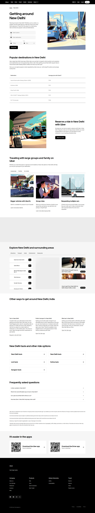

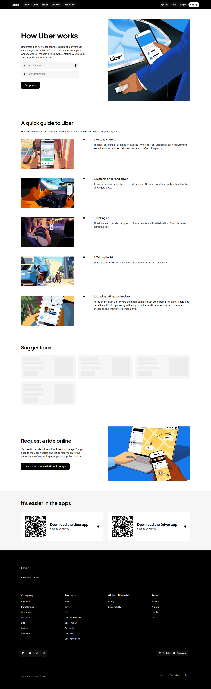


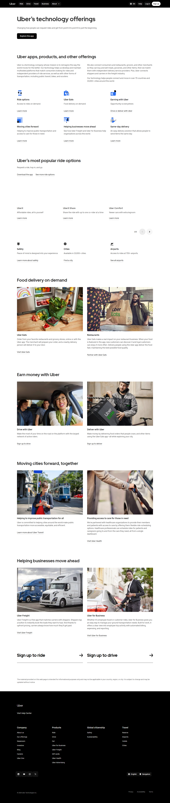

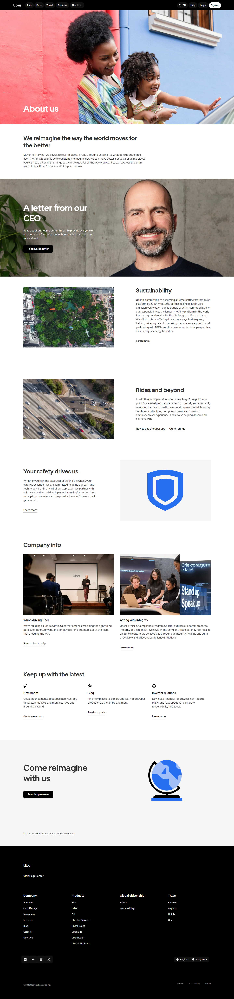


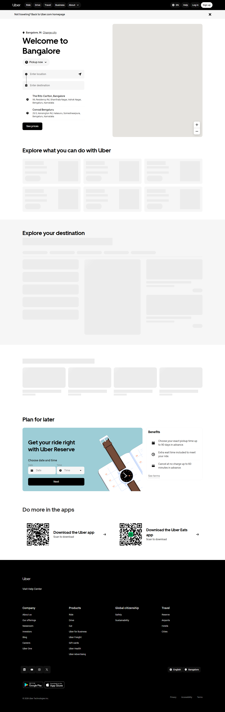

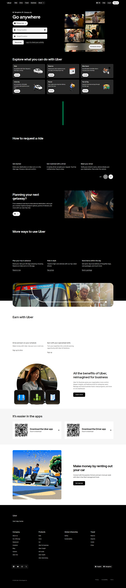

### Section Clips (screens/sections/)

*Clipped individual sections and components*

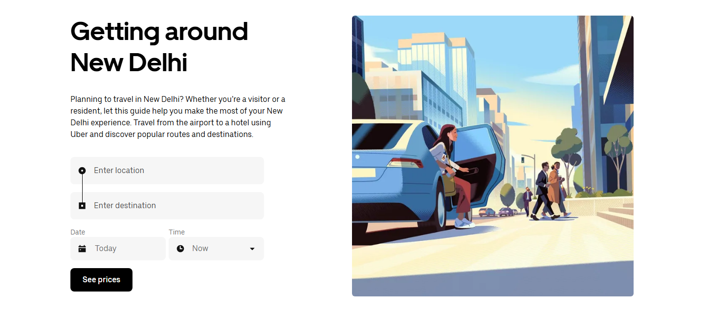


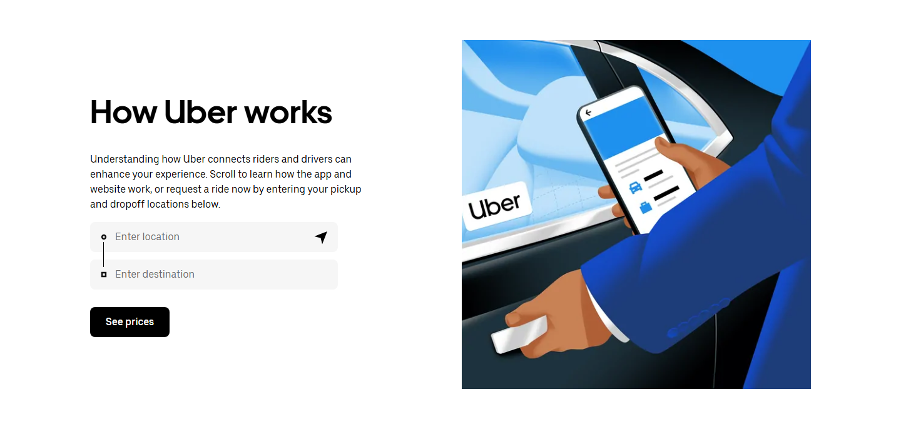


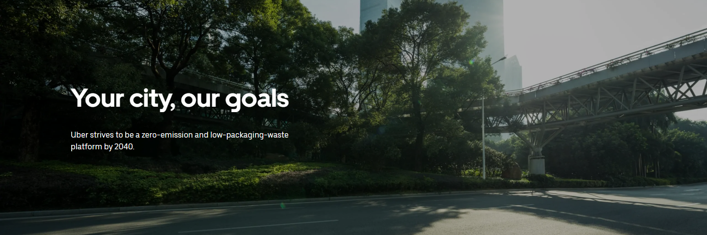


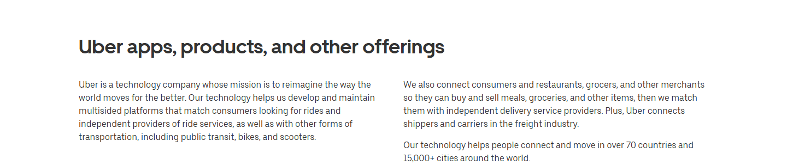

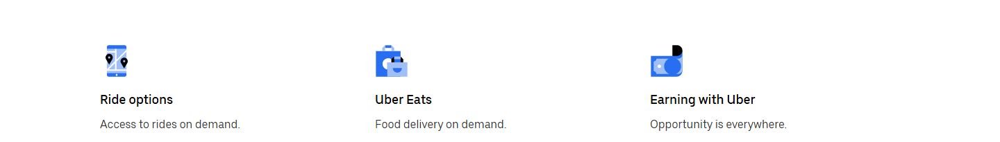

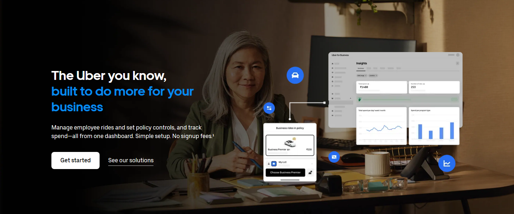


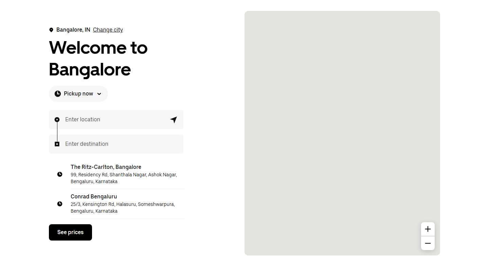

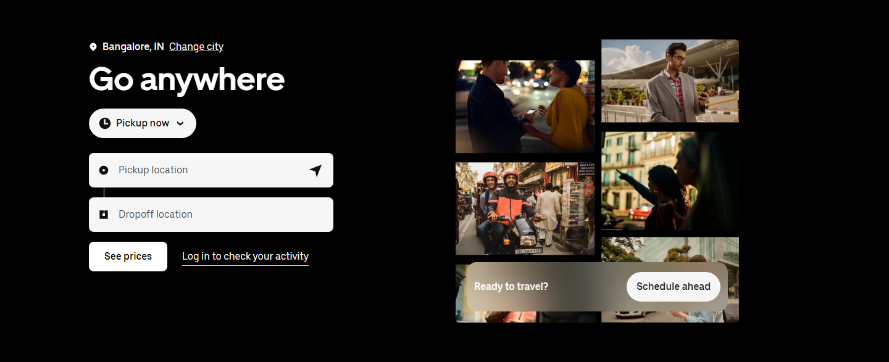

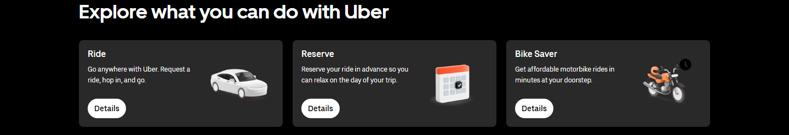

### Interaction States (screens/states/)

*Hover, focus, and active state captures*


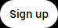

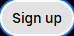

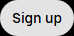


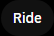


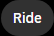

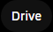

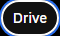

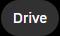


### Screenshot Index (screens/INDEX.md)

# Screenshot Index

## Scroll Journey

> Shows the cinematic state at each point of the page

| Scroll | Y Position | File |
|--------|-----------|------|
| 0% | 0px | `screens/scroll/scroll-000.png` |
| 17% | 980px | `screens/scroll/scroll-017.png` |
| 33% | 1903px | `screens/scroll/scroll-033.png` |
| 50% | 2884px | `screens/scroll/scroll-050.png` |
| 67% | 3864px | `screens/scroll/scroll-067.png` |
| 83% | 4787px | `screens/scroll/scroll-083.png` |
| 100% | 5767px | `screens/scroll/scroll-100.png` |

## Pages

| Page | URL | File |
|------|-----|------|
| Earn Money by Driving or Get a Ride Now | Uber India | `https://www.uber.com/in/en/` | `screens/pages/in-en.png` |
| Explore the Uber Platform | Earn & Ride | Uber | `https://www.uber.com/in/en/city-hub/` | `screens/pages/in-en-city-hub.png` |
| Corporate Travel, Food, & Delivery Services | Uber for Business | `https://www.uber.com/in/en/business/` | `screens/pages/in-en-business.png` |
| About Us | Uber | `https://www.uber.com/in/en/about/` | `screens/pages/in-en-about.png` |
| Uber Apps, Products, and Offerings | Uber | `https://www.uber.com/in/en/about/uber-offerings/` | `screens/pages/in-en-about-uber-offerings.png` |
| How Uber Works for Drivers and Riders | Overview | `https://www.uber.com/in/en/about/how-does-uber-work/` | `screens/pages/in-en-about-how-does-uber-work.png` |
| Our Road to Zero Emissions | Uber | `https://www.uber.com/in/en/about/sustainability/` | `screens/pages/in-en-about-sustainability.png` |
| Uber in New Delhi | A Guide to Getting Around in New Delhi | `https://www.uber.com/global/en/r/cities/new-delhi-new-delhi-in/` | `screens/pages/global-en-r-cities-new-delhi-new-delhi-in.png` |

## Sections

| Page | Section | File |
|------|---------|------|
| in-en | #1 (section) | `screens/sections/in-en-section-1.png` |
| in-en | #2 (section) | `screens/sections/in-en-section-2.png` |
| in-en-city-hub | #1 (section) | `screens/sections/in-en-city-hub-section-1.png` |
| in-en-business | #1 (section) | `screens/sections/in-en-business-section-1.png` |
| in-en-business | #2 (section) | `screens/sections/in-en-business-section-2.png` |
| in-en-about | #1 (section) | `screens/sections/in-en-about-section-1.png` |
| in-en-about | #2 (section) | `screens/sections/in-en-about-section-2.png` |
| in-en-about-uber-offerings | #1 (section) | `screens/sections/in-en-about-uber-offerings-section-1.png` |
| in-en-about-uber-offerings | #2 (section) | `screens/sections/in-en-about-uber-offerings-section-2.png` |
| in-en-about-uber-offerings | #3 (section) | `screens/sections/in-en-about-uber-offerings-section-3.png` |
| in-en-about-how-does-uber-work | #1 (section) | `screens/sections/in-en-about-how-does-uber-work-section-1.png` |
| in-en-about-how-does-uber-work | #2 (section) | `screens/sections/in-en-about-how-does-uber-work-section-2.png` |
| in-en-about-sustainability | #1 (section) | `screens/sections/in-en-about-sustainability-section-1.png` |
| in-en-about-sustainability | #2 (section) | `screens/sections/in-en-about-sustainability-section-2.png` |
| global-en-r-cities-new-delhi-new-delhi-in | #1 (section) | `screens/sections/global-en-r-cities-new-delhi-new-delhi-in-section-1.png` |
| global-en-r-cities-new-delhi-new-delhi-in | #2 (section) | `screens/sections/global-en-r-cities-new-delhi-new-delhi-in-section-2.png` |

## Homepage Screenshots (screenshots/)


