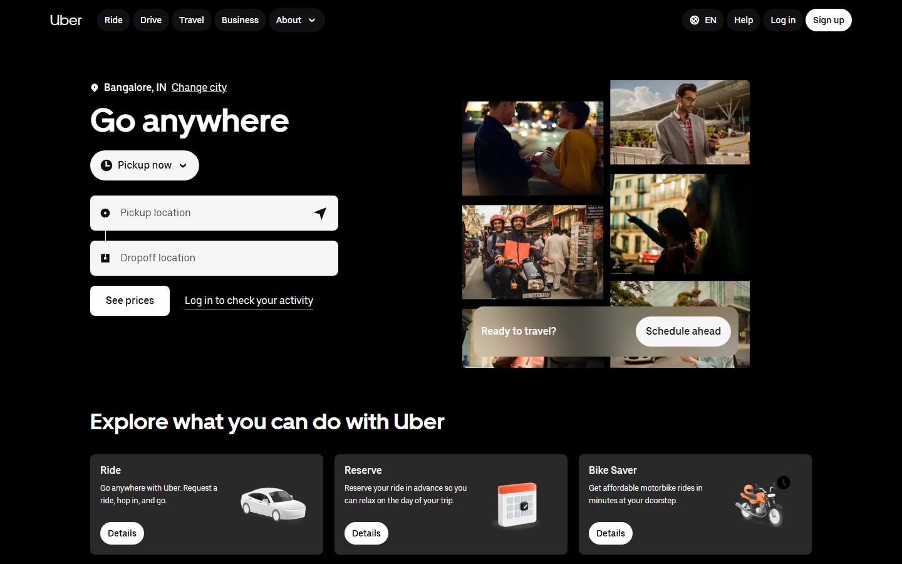
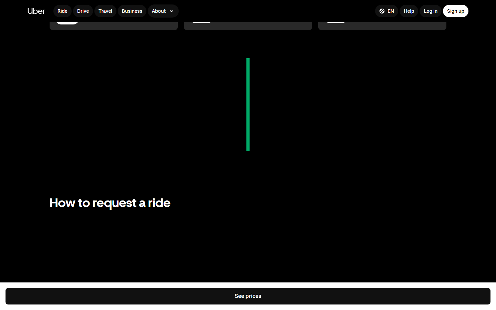
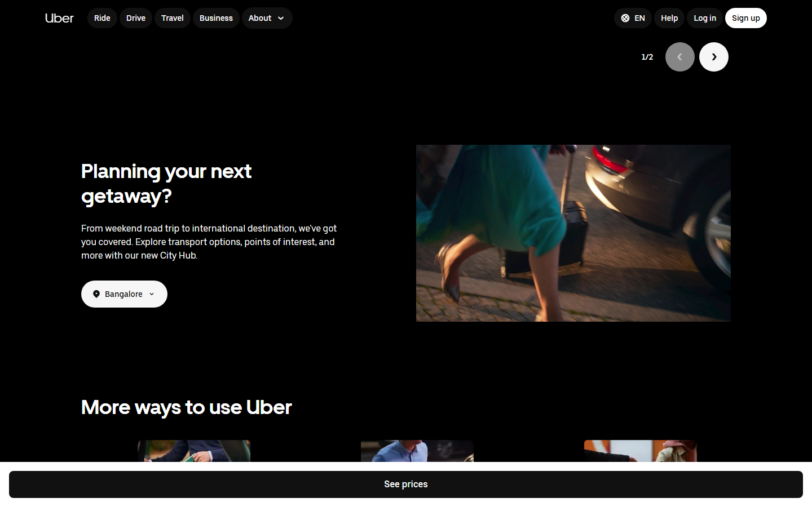
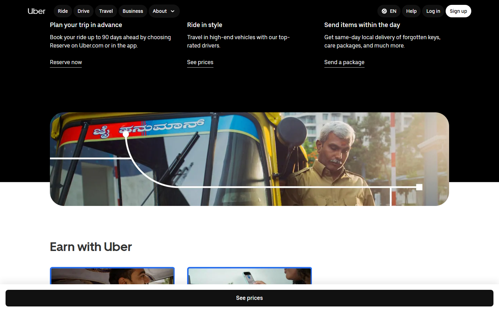
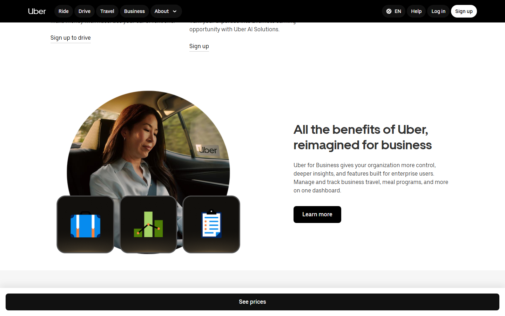
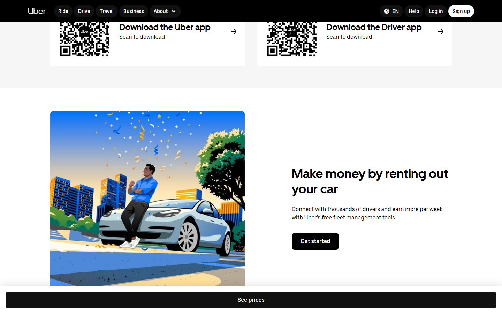
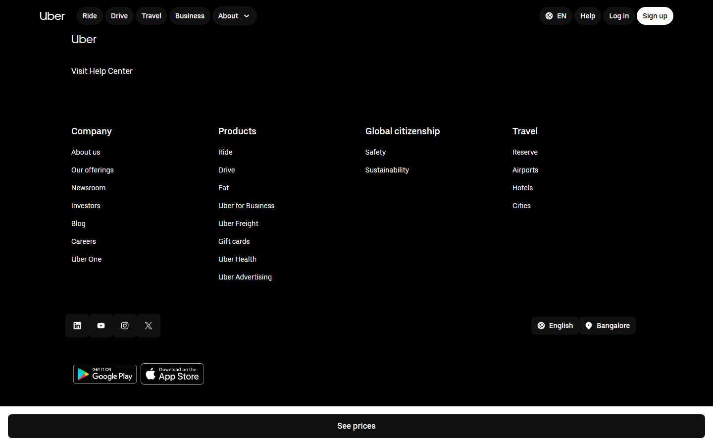

# Animation Reference

> Cinematic motion design extracted from live DOM. Follow these specs exactly to recreate the experience.

## Motion Technology Stack

Pure CSS animations — no external animation libraries detected.

## Scroll Journey

The page is **6,667px** tall. Each frame below shows what the user sees at that scroll depth.

> **Use these screenshots to understand WHAT animates, WHEN it animates, and HOW it moves.**

### 0% — Top / Hero
Scroll position: 0px



### 17% — Opening Section
Scroll position: 980px



### 33% — First Feature Section
Scroll position: 1,903px



### 50% — Mid-Page
Scroll position: 2,884px



### 67% — Lower Content
Scroll position: 3,864px



### 83% — Near Footer
Scroll position: 4,787px



### 100% — Bottom / Footer
Scroll position: 5,767px



## Video Elements

| # | Role | Autoplay | Loop | Muted | Size | First Frame |
|---|------|----------|------|-------|------|-------------|
| 1 | content | ✓ | ✓ | ✓ | 558×318 | — |

- **Source:** `https://tb-static.uber.com/prod/uber-static/uber-sites/_video/Global Brand Experience/Go Get 2026/Event Day/02_Travel Mo`

## CSS Keyframes (2 extracted)

### `@keyframes animation-dkKkL`

Duration: `1.5s` · Easing: `ease-out` · Iteration: `infinite`

Used by: `.css-cCIVXL`, `.css-jUdoY`, `.css-bcXLoD`, `.css-iLAuZp`

```css
@keyframes animation-dkKkL {
  0% {
    background-position-x: 100%;
    background-position-y: 50%;
  }
  100% {
    background-position-x: 0%;
    background-position-y: 50%;
  }
}
```

> Background color/gradient shift · Background position (shimmer/scroll)

### `@keyframes action-button-module__action-button-spin___GydB6`

Duration: `700ms` · Easing: `linear` · Delay: `0s` · Iteration: `infinite` · Fill: `none`

Used by: `.action-button-module__loadingSpinner___U9YXk`

```css
@keyframes action-button-module__action-button-spin___GydB6 {
  0% {
    transform: rotate(0deg);
  }
  100% {
    transform: rotate(360deg);
  }
}
```

> Transform/motion animation

## Global Transition Declarations

These `transition` values were extracted from CSS rules across the site:

```css
transition: transform 200ms ease-out;
transition: 0.3s ease-in-out;
transition: 200ms cubic-bezier(0.4, 0, 0.2, 1);
transition: 200ms;
transition: 500ms cubic-bezier(0.22, 1, 0.36, 1);
transition: backgroundColor 500ms;
transition: transform 1000ms cubic-bezier(0.2, 0.8, 0.4, 1);
transition: 400ms;
transition: height 0.2s linear;
transition: width 0.3s linear;
transition: background-color 0.218s, border-color 0.218s;
transition: background-color 0.218s;
```

## How to Recreate This Motion Design

### Step 2 — Scroll-Reveal Pattern

Elements that animate into view follow this pattern:

```css
/* Initial hidden state */
.reveal {
  opacity: 0;
  transform: translateY(40px);
  transition: opacity 200ms cubic-bezier(0.4, 0, 0.2, 1),
              transform 200ms cubic-bezier(0.4, 0, 0.2, 1);
}
.reveal.visible {
  opacity: 1;
  transform: translateY(0);
}
```

### Step 3 — Key Motion Principles

- **Duration scale:** `200ms` · `0.3s` · `500ms` — use these values, never invent new durations
- **Always add** `@media (prefers-reduced-motion: reduce) { * { animation-duration: 0.01ms !important; transition-duration: 0.01ms !important; } }`

### Step 4 — Scroll Journey Reference

Match what happens at each scroll position:

- **0%** (`0px`) → `screens/scroll/scroll-000.png`
- **17%** (`980px`) → `screens/scroll/scroll-017.png`
- **33%** (`1903px`) → `screens/scroll/scroll-033.png`
- **50%** (`2884px`) → `screens/scroll/scroll-050.png`
- **67%** (`3864px`) → `screens/scroll/scroll-067.png`
- **83%** (`4787px`) → `screens/scroll/scroll-083.png`
- **100%** (`5767px`) → `screens/scroll/scroll-100.png`

