# Uber UI Reference — Visual Guide

> Master visual reference. Study every screenshot carefully before implementing any UI.
> Match colors, layout, typography, spacing, and motion states exactly.

## Scroll Journey

The page has cinematic scroll animations. Each screenshot below shows the exact visual state at that scroll depth.
**Replicate these transitions precisely** — the design changes dramatically as you scroll.

### Hero — Above the fold

*Scroll position: 0px of 6667px total*

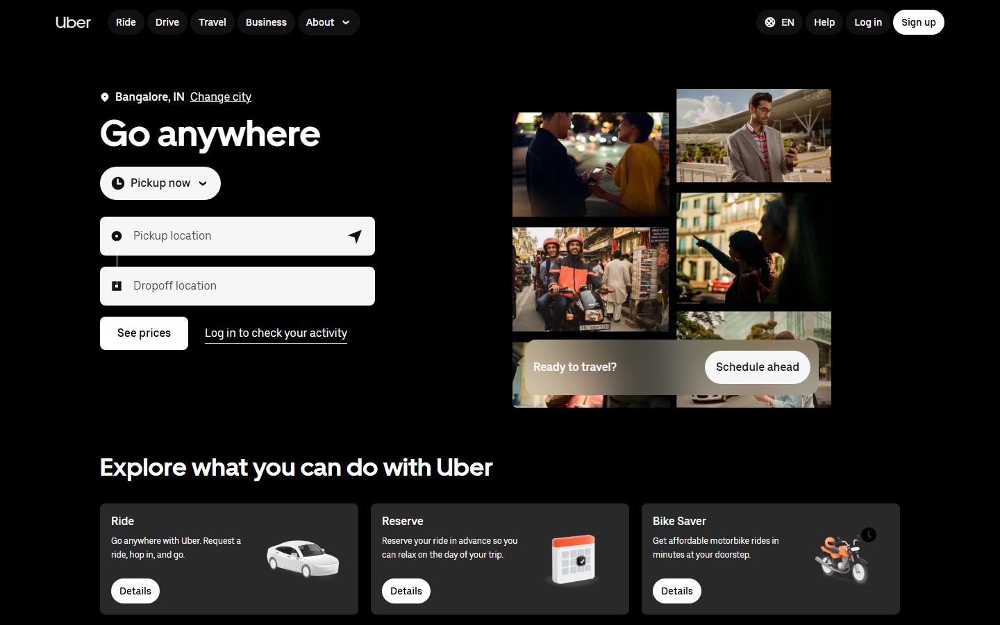

### 17% scroll depth

*Scroll position: 980px of 6667px total*

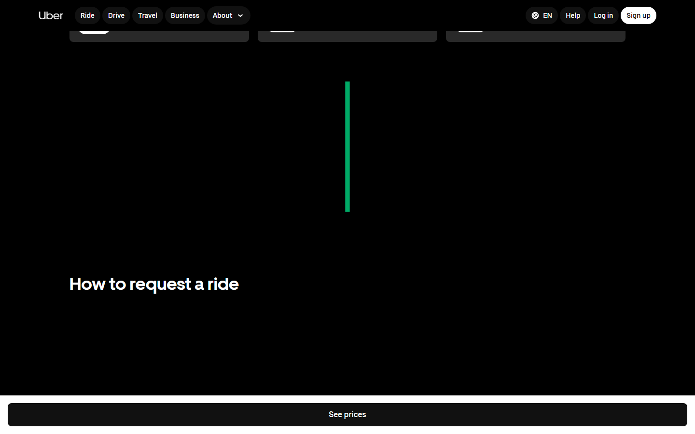

### 33% scroll depth

*Scroll position: 1903px of 6667px total*

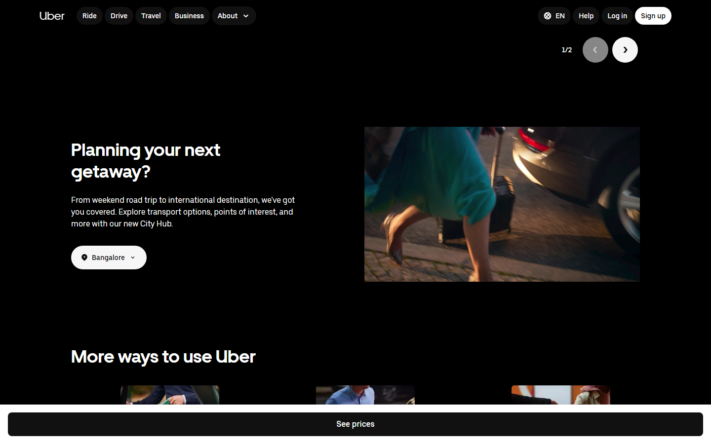

### 50% scroll depth

*Scroll position: 2884px of 6667px total*

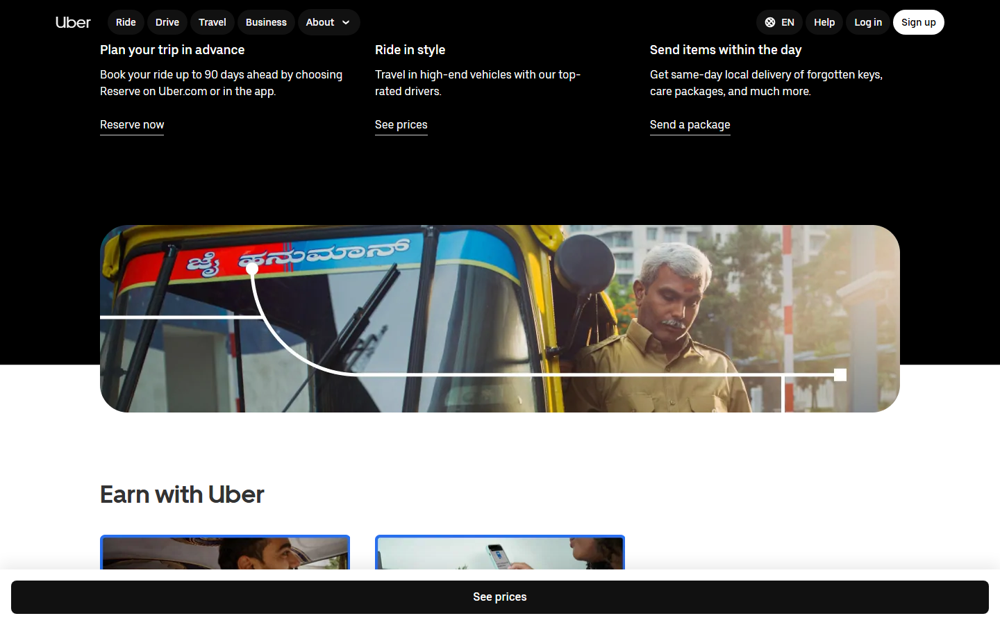

### 67% scroll depth

*Scroll position: 3864px of 6667px total*

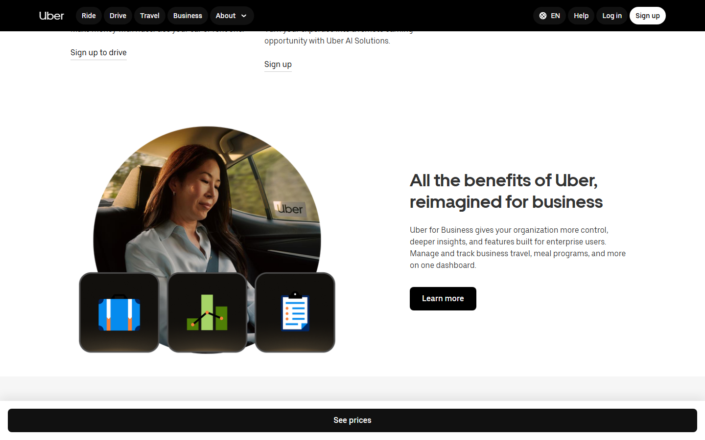

### 83% scroll depth

*Scroll position: 4787px of 6667px total*

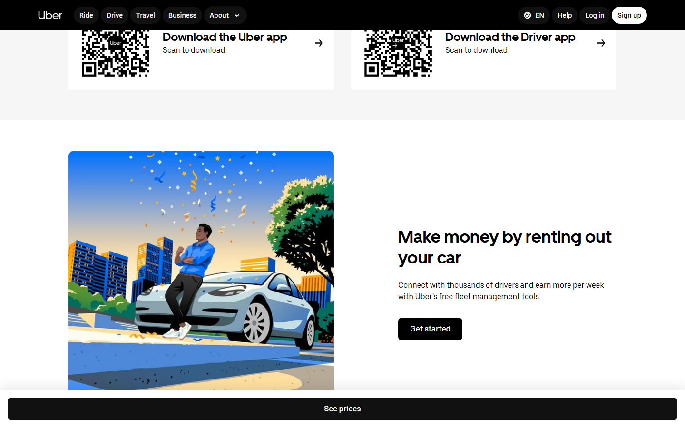

### Footer — End of page

*Scroll position: 5767px of 6667px total*

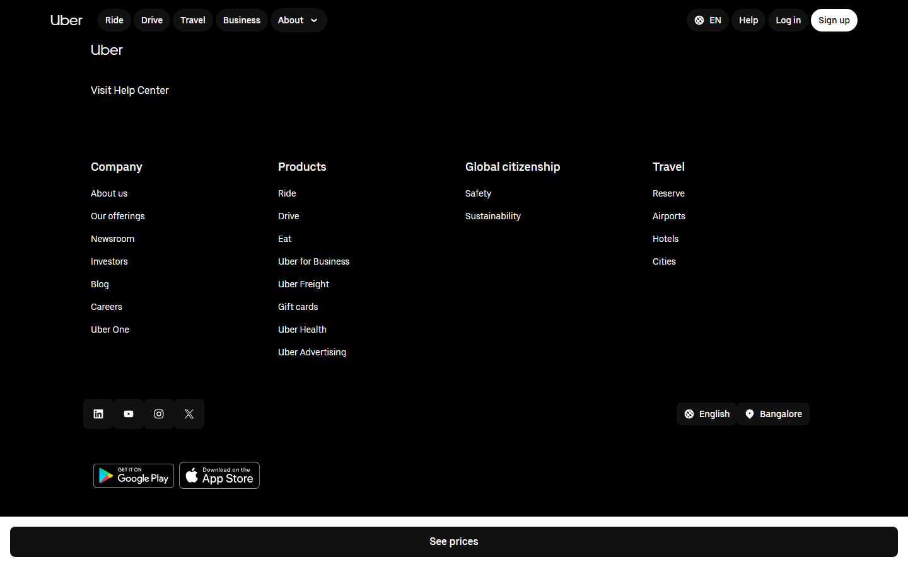

## Full Page Screenshots

### Earn Money by Driving or Get a Ride Now | Uber India

*URL: `https://www.uber.com/in/en/`*

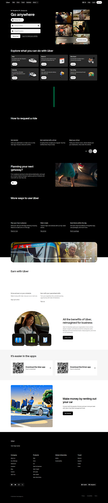

### Explore the Uber Platform | Earn & Ride | Uber

*URL: `https://www.uber.com/in/en/city-hub/`*

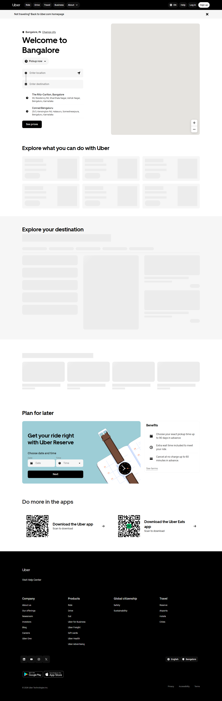

### Corporate Travel, Food, & Delivery Services | Uber for Business

*URL: `https://www.uber.com/in/en/business/`*

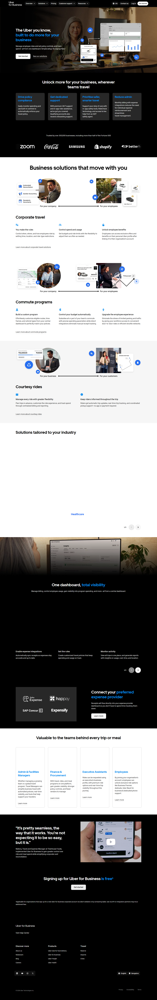

### About Us | Uber

*URL: `https://www.uber.com/in/en/about/`*

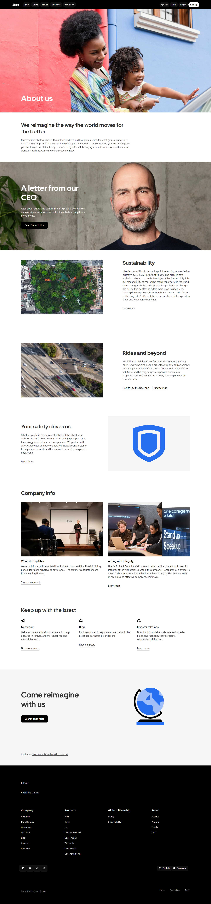

### Uber Apps, Products, and Offerings | Uber

*URL: `https://www.uber.com/in/en/about/uber-offerings/`*

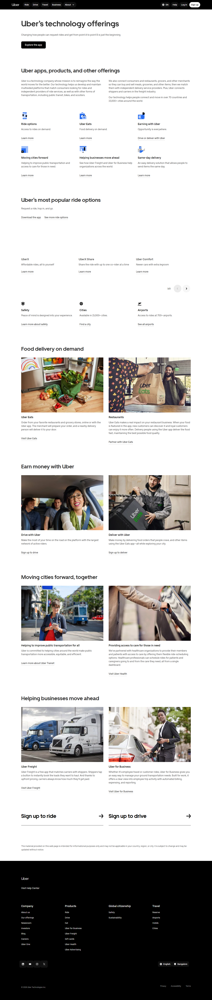

### How Uber Works for Drivers and Riders | Overview

*URL: `https://www.uber.com/in/en/about/how-does-uber-work/`*

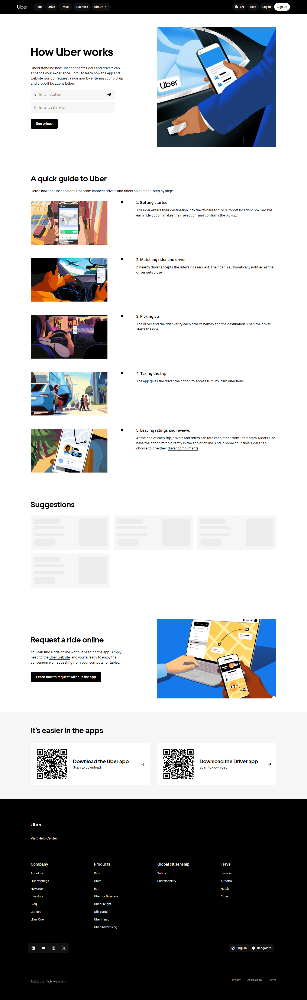

### Our Road to Zero Emissions | Uber

*URL: `https://www.uber.com/in/en/about/sustainability/`*

### Uber in New Delhi | A Guide to Getting Around in New Delhi

*URL: `https://www.uber.com/global/en/r/cities/new-delhi-new-delhi-in/`*

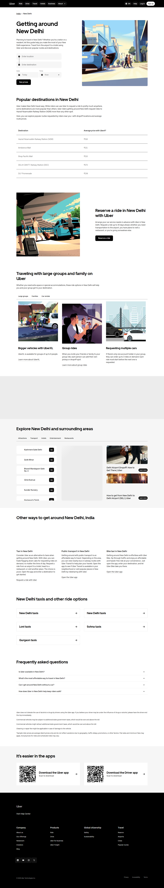

## Section Screenshots

Clipped sections showing individual components in context.

### Section 1 — `section`

*1440×587px*

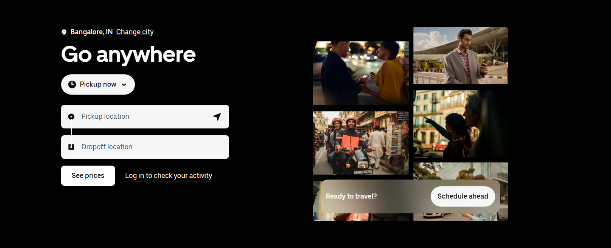

### Section 2 — `section`

*1440×434px*

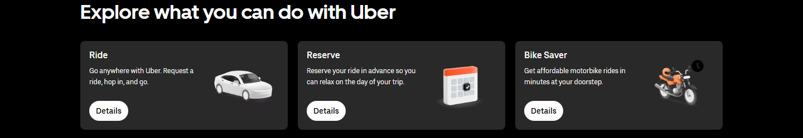

### Section 1 — `section`

*1440×816px*

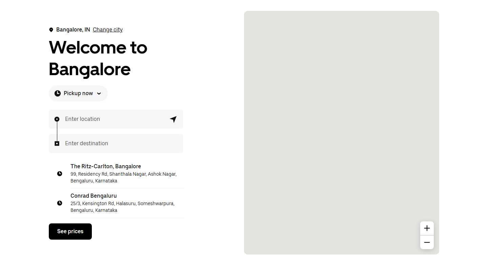

### Section 1 — `section`

*1440×600px*

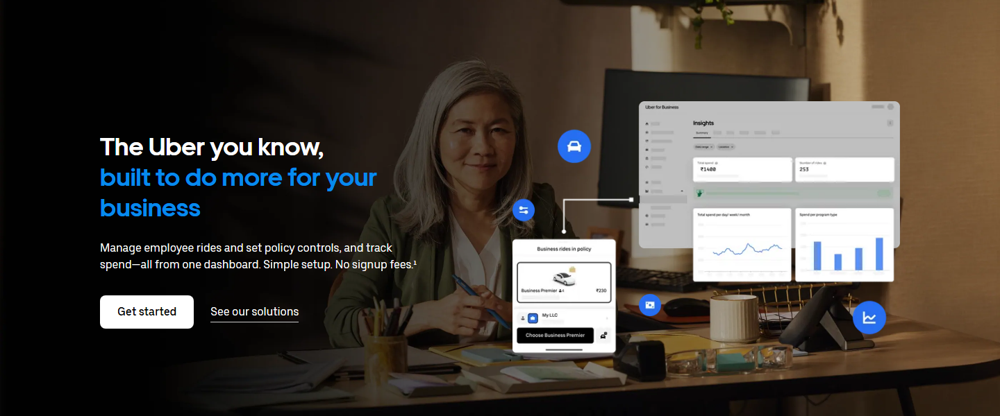

### Section 2 — `section`

*1440×346px*

### Section 1 — `section`

*1440×700px*

### Section 2 — `section`

*1440×336px*

### Section 1 — `section`

*1440×328px*

### Section 2 — `section`

*1440×303px*

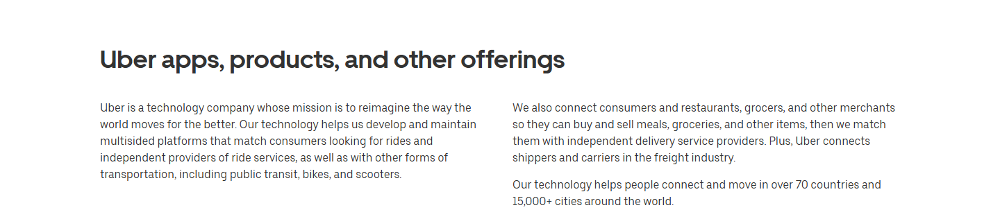

### Section 3 — `section`

*1440×572px*

### Section 1 — `section`

*1440×686px*

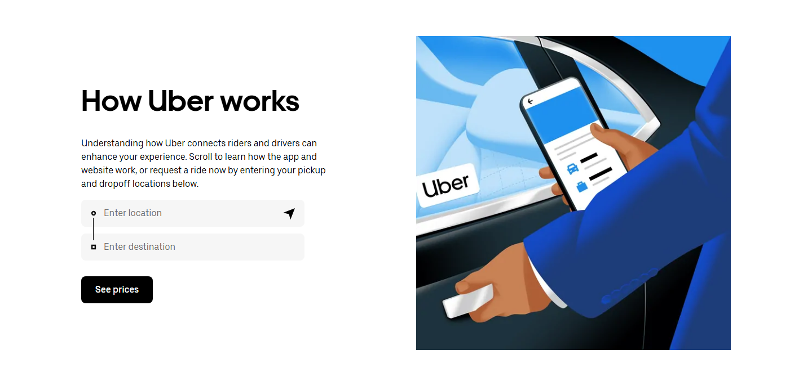

### Section 2 — `section`

*1440×1200px*

### Section 1 — `section`

*1440×480px*

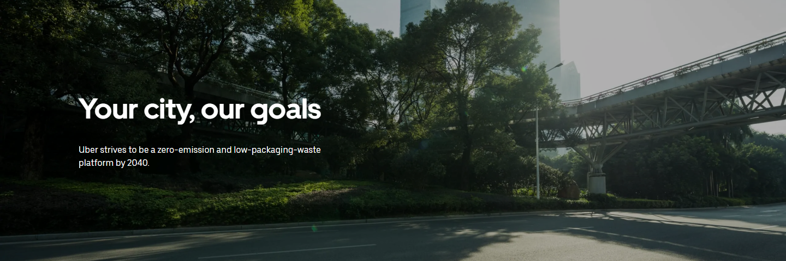

### Section 2 — `section`

*1440×1200px*

### Section 1 — `section`

*1440×640px*

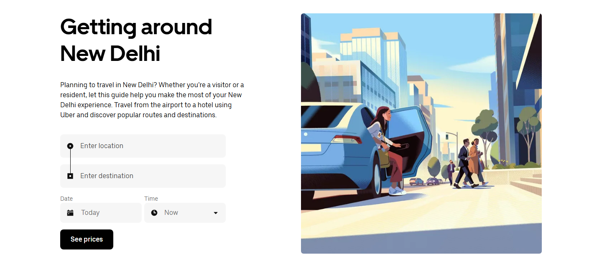

### Section 2 — `section`

*1440×835px*

